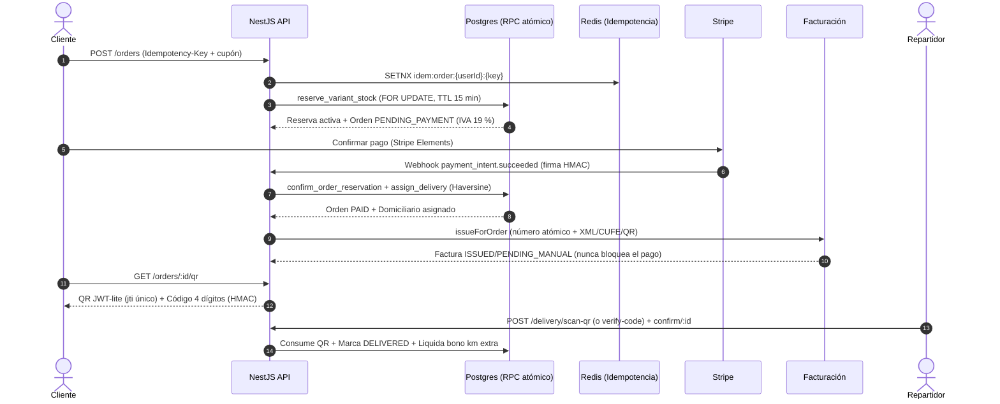

# ARShop — E-Commerce & Last-Mile Logistics Platform

> **"Moda oculta, sin sede física."**
>
> Plataforma full-stack de comercio electrónico y logística de última milla para moda minimalista en Colombia. Combina garantías transaccionales de grado bancario, reservas de inventario con bloqueo pesimista (`FOR UPDATE`), verificación criptográfica de entregas con QR dinámico (`JWT-lite` + `HMAC`), facturación electrónica DIAN simulada en ambiente de habilitación y cumplimiento normativo colombiano (**Ley 1480** Estatuto del Consumidor, **Ley 1581** Habeas Data e IVA 19 %).

**Estado:** portafolio funcional end-to-end. Backend NestJS 10, frontend Next.js 16, Supabase/PostgreSQL, Stripe, Redis/BullMQ, Resend y facturación DIAN en modo demostración. La suite actual tiene **17 suites y 79 pruebas** (unitarias + E2E HTTP).

---

## Índice

| # | Sección | Qué encontrarás |
|---|---|---|
| 1 | [Resumen](#resumen) | Propuesta de valor y capacidades principales |
| 2 | [Glosario](#glosario) | Términos de negocio, fiscales y técnicos |
| 3 | [Modo demo portafolio](#modo-demo-portafolio) | Acceso 1-clic a los 3 roles sin tocar la base real |
| 4 | [Qué incluye la plataforma](#qué-incluye-la-plataforma) | Funcionalidades por rol (cliente, admin, repartidor) |
| 5 | [Arquitectura del sistema](#arquitectura-del-sistema) | Diagrama de componentes e infraestructura |
| 6 | [Flujo transaccional](#flujo-transaccional) | Inventario → pago → factura → entrega verificada |
| 7 | [Facturación electrónica DIAN](#facturación-electrónica-dian) | Estado, proveedores, endpoints, modelo y límites |
| 8 | [Inventario y prevención de sobreventa](#inventario-y-prevención-de-sobreventa) | Reservas atómicas, TTL y limpieza distribuida |
| 9 | [Pagos e idempotencia](#pagos-e-idempotencia) | Stripe, webhooks HMAC y checkout sin duplicados |
| 10 | [Logística y entrega verificada](#logística-y-entrega-verificada) | QR firmado, código de 4 dígitos, PIN y disputas |
| 11 | [Devoluciones, retracto y cumplimiento](#devoluciones-retracto-y-cumplimiento) | RMA, Ley 1480, cancelaciones y reembolsos |
| 12 | [Autenticación, MFA y correo](#autenticación-mfa-y-correo) | Cookies httpOnly, TOTP, lockout y Resend |
| 13 | [Seguridad y hardening](#seguridad-y-hardening) | RLS, CSP, gates de rutas y secretos |
| 14 | [Búsqueda, catálogo y moneda](#búsqueda-catálogo-y-moneda) | Full-text, filtros, drops y multimoneda |
| 15 | [Resiliencia e infraestructura](#resiliencia-e-infraestructura) | Redis fallback, BullMQ, cold start y logs |
| 16 | [Frontend y UX](#frontend-y-ux) | Checkout móvil, PWA, design system y detalles |
| 17 | [Stack tecnológico](#stack-tecnológico) | Versiones y dependencias principales |
| 18 | [Mapa del repositorio](#mapa-del-repositorio) | Estructura de carpetas y archivos clave |
| 19 | [Dónde tocar cada cosa](#dónde-tocar-cada-cosa) | Guía rápida de mantenimiento |
| 20 | [Ejecución local](#ejecución-local) | Instalación, migraciones y arranque |
| 21 | [Variables de entorno](#variables-de-entorno) | Configuración mínima de backend y frontend |
| 22 | [Pruebas](#pruebas) | Suites, cobertura funcional y comandos |
| 23 | [CI/CD, SEO y observabilidad](#cicd-seo-y-observabilidad) | GitHub Actions, Pino, sitemap y JSON-LD |
| 24 | [Checklist de despliegue](#checklist-de-despliegue) | Migraciones, secretos y humo post-deploy |
| 25 | [Plan de escalabilidad](#plan-de-escalabilidad) | Fases, costos y disparadores |
| 26 | [Roadmap](#roadmap) | Mejoras priorizadas si hubiera más tiempo |
| 27 | [Documentación](#documentación) | Documentos técnicos del repositorio |
| 28 | [Licencia y uso](#licencia-y-uso) | Alcance del portafolio y condiciones de uso |

> **Convención de enlaces:** todas las rutas son relativas a la raíz del repositorio.

---

## Resumen

ARShop es una tienda de moda minimalista sin sede física. El comprador navega un catálogo editorial, compra con Stripe, recibe un pedido con seguimiento y confirma la entrega con un QR firmado o un código de 4 dígitos. El administrador opera catálogo, pedidos, usuarios, repartidores, disputas y facturación. El repartidor gestiona sus entregas, escanea el QR y acumula bonos por kilometraje extra.

Capacidades diferenciales:

- **Inventario sin sobreventa**: reservas temporales con `FOR UPDATE`, expiración a 15 minutos y limpieza con lock distribuido.
- **Pago idempotente**: `Idempotency-Key` en checkout y webhooks de Stripe verificados con firma HMAC.
- **Entrega antifraude**: QR de un solo uso (`jti`) + código de 4 dígitos ligado a la orden; la entrega simulada nunca se autoacepta.
- **Cumplimiento colombiano**: retracto/cambio en días hábiles (Ley 1480), Habeas Data (Ley 1581) y desglose fiscal con IVA 19 %.
- **Facturación DIAN**: XML UBL 2.1, CUFE SHA-384, QR y representación imprimible; hoy en modo **simulado/habilitación**, sin transmisión real a la DIAN.
- **Resiliencia**: si Redis falla, el backend conmuta a memoria RAM sin romper autenticación ni rate limiting; si Stripe o la DIAN fallan, el pedido pagado no se bloquea.

---

## Glosario

| Término | Significado en ARShop |
|---|---|
| **ARShop** | Nombre del proyecto y de la tienda ficticia usada en el sandbox. |
| **Variante / SKU** | Combinación talla-color de un producto; es la unidad real de inventario y de reserva. |
| **Drop** | Ventana de lanzamiento con fecha de inicio/fin; el catálogo puede ocultar o destacar productos. |
| **Overselling** | Venta de más unidades de las disponibles; se evita con reservas atómicas. |
| **Reserva** | Bloqueo temporal de stock durante el checkout, con TTL de 15 minutos. |
| **`FOR UPDATE`** | Bloqueo pesimista de filas en PostgreSQL para serializar operaciones concurrentes. |
| **`SKIP LOCKED`** | Técnica para que varios workers tomen filas distintas sin esperarse entre sí. |
| **RPC** | Función de PostgreSQL expuesta a Supabase; aquí concentra las operaciones atómicas. |
| **RLS** | Row-Level Security de PostgreSQL/Supabase; controla qué filas puede leer o escribir cada rol. |
| **Idempotencia** | Propiedad por la cual reintentar la misma operación no duplica el efecto. |
| **`Idempotency-Key`** | Cabecera del checkout que identifica un intento único de compra. |
| **HMAC** | Firma criptográfica usada en webhooks de Stripe y en la vigencia de códigos/QR. |
| **`jti`** | Identificador único del QR; se consume una sola vez para evitar reutilización. |
| **RMA** | Return Merchandise Authorization: solicitud de devolución, cambio o garantía. |
| **Retracto** | Derecho del consumidor a devolver una compra dentro de un plazo legal (Ley 1480). |
| **Ley 1480** | Estatuto del Consumidor de Colombia; regula retracto, garantías y reversión. |
| **Ley 1581** | Régimen de protección de datos personales (Habeas Data) en Colombia. |
| **FEV** | Factura Electrónica de Venta ante la DIAN. |
| **DIAN** | Dirección de Impuestos y Aduanas Nacionales de Colombia. |
| **CUFE** | Código Único de Factura Electrónica; huella del documento fiscal. |
| **UBL 2.1** | Estándar XML usado por la DIAN para facturación electrónica. |
| **Habilitación / Producción** | Ambientes DIAN. El proyecto usa `HABILITACION`; `PRODUCCION` exige proveedor real. |
| **`DIAN_SIMULATED`** | Proveedor local de demostración: genera XML/CUFE/QR y simula aceptación sin transmitir. |
| **Base gravable** | Valor sobre el que se calcula el IVA; en ARShop incluye prendas y envío, menos descuentos. |
| **IVA 19 %** | Impuesto sobre las ventas colombiano, incluido en los precios mostrados. |
| **COP / USD / EUR** | Monedas soportadas; la factura fiscal siempre se emite en COP. |
| **MFA / TOTP** | Autenticación multifactor; TOTP es el código temporal de apps como Google Authenticator. |
| **RBAC** | Control de acceso basado en roles (`CUSTOMER`, `ADMIN`, `REPARTIDOR`). |
| **JWT-lite** | Token firmado y de vida corta usado para el QR de entrega. |
| **PWA** | Aplicación web instalable con service worker y manifest. |
| **VAPID** | Par de claves para Web Push sin depender de FCM/APNs. |
| **BullMQ** | Cola de trabajos en segundo plano sobre Redis. |
| **Cold start** | Tiempo de arranque de una instancia dormida (Render free: 20-50 s). |
| **Sandbox demo** | Base de datos reactiva en memoria del navegador; no toca Supabase. |

---

## Modo demo portafolio

En [`/cuenta`](./apps/web/src/app/cuenta/page.tsx) existe el bloque **Modo Demo Portafolio · Acceso 1-Clic**, que aprovisiona e inicia sesión al instante en cualquiera de los **3 roles del ecosistema** sin tocar la base de datos real:

| Rol | Cuenta demo | Qué puedes probar |
|---|---|---|
| **Cliente** | `demo.cliente@arshop.co` | Catálogo con filtros y buscador con sinónimos colombianos, guía de tallas interactiva, cupones (`BIENVENIDO10`, `DROP15`, `ARSHOP30K`), checkout idempotente con Stripe (`4242 4242 4242 4242`), QR de recepción, cancelación pre-envío, comprobante de pedido y solicitudes de retracto/cambio de talla (Ley 1480). |
| **Admin** | `demo.admin@arshop.co` | CRUD de productos y variantes, ventanas de lanzamiento (*drops*), motor de búsqueda aislado + exportación JSON, despacho con transportadora nacional (*Servientrega, Coordinadora, Interrapidísimo, TCC*) o asignación de domiciliario, arbitraje de disputas, resolución de RMA con reembolso automático en Stripe y **facturación electrónica simulada**. |
| **Repartidor** | `demo.repartidor@arshop.co` | Panel de entregas asignadas (`/domiciliario`), escáner de QR firmado con cámara, validación de código numérico de 4 dígitos con protección brute-force, entrega simulada protegida por PIN y billetera de bonos por kilometraje extra (`/domiciliario/bonos`). |

**Garantías del sandbox en navegador:**

- **Cero contacto con la DB real**: el modo demo corre sobre una base reactiva en memoria en el cliente ([`demo-store.ts`](./apps/web/src/lib/demo-store.ts)). Las mutaciones (crear productos, actualizar pedidos, despachar) persisten en `sessionStorage` y se resetean al salir.
- **Sesión temporal de 30 minutos**: un widget flotante ([`demo-banner.tsx`](./apps/web/src/components/demo-banner.tsx)) muestra la cuenta regresiva y permite *"Reiniciar datos"* o *"Salir del modo demo"*.
- **Protección backend**: `DEMO_MODE_DISABLED=true` en producción impide que las llamadas demo contaminen usuarios o tablas en Supabase.

---

## Qué incluye la plataforma

### Visitante

- Home editorial con catálogo segmentado por género y categoría.
- Filtros por talla, color, precio y disponibilidad; búsqueda con sinónimos colombianos.
- Guía de tallas interactiva, selector de moneda (COP/USD/EUR) y páginas legales.
- Ficha de producto con datos estructurados Schema.org (`Product` JSON-LD).
- PWA instalable, sitemap y robots.

### Cliente

- Registro con verificación de correo por enlace o código OTP.
- Login con cookies `httpOnly`, refresh rotation y MFA (TOTP o código por email).
- Perfil, direcciones múltiples y dirección predeterminada.
- Carrito, cupones, checkout con Stripe Elements y captura opcional de datos de facturación.
- Historial de pedidos, detalle, QR de recepción, cancelación pre-envío y comprobante de pedido.
- Solicitudes de retracto/cambio de talla dentro de los plazos legales.
- Notificaciones push y correos transaccionales.
- Tarjeta de factura con número, estado, CUFE y enlace público cuando existe una FEV emitida.

### Administrador

- Dashboard, CRUD de productos/variantes, imágenes, drops y exportación JSON.
- Búsqueda administrativa aislada y reindexación.
- Pedidos: despacho con transportadora o asignación de domiciliario, cancelación y reembolso.
- Usuarios: roles, bloqueos, altas masivas, MFA y auditoría.
- Domiciliarios: fichas, disponibilidad, zona, vehículo y placa.
- Disputas de entrega y devoluciones/RMA.
- **Facturación**: listado, emisión, reintentos, registro manual de CUFE, descargas XML/representación y notas crédito.
- Logs de auditoría y configuración.

### Repartidor

- Entregas asignadas, detalle del pedido y datos de contacto del cliente.
- Escaneo de QR con cámara o ingreso manual del código de 4 dígitos.
- Entrega simulada con PIN personal o declaración auditada (`skipPin`), sin autoaceptar el pedido.
- Billetera de bonos por kilómetro extra.
- Configuración de zona (departamento/ciudad con dropdowns), vehículo, placa, PIN y push.

---

## Arquitectura del sistema


> **Nota:** la flecha punteada de proveedores hacia la DIAN sólo aplica al adaptador real `DIAN_OWN`. El modo por defecto (`DIAN_SIMULATED`) genera todo localmente y no transmite.

---

## Flujo transaccional



**Regla de oro:** la facturación y las notificaciones son efectos secundarios. Si fallan, la orden sigue `PAID` y queda pendiente de reintento; nunca se revierte un pago por un fallo de la DIAN o del correo.

---

## Facturación electrónica DIAN

> **Estado actual:** implementada en modo **demostración**. El proveedor por defecto es `DIAN_SIMULATED` en ambiente `HABILITACION`: genera XML UBL 2.1, CUFE SHA-384, QR y representación imprimible, y simula una aceptación. **No firma con certificado real ni transmite a la DIAN.**

El análisis legal y de diseño completo está en [`docs/FACTURACION_DIAN.md`](./docs/FACTURACION_DIAN.md).

### Proveedores disponibles

| Proveedor | Comportamiento actual | Uso previsto |
|---|---|---|
| `DIAN_SIMULATED` | Genera XML/CUFE/QR y responde `ISSUED` con track de habilitación simulado. | Demos y pruebas end-to-end (valor por defecto). |
| `DIAN_FREE` | Genera el XML y deja la factura en `PENDING_MANUAL`. | Facturación Gratuita DIAN: radicación manual en el portal y registro posterior de número/CUFE. |
| `DIAN_OWN` | Genera XML local y responde `FAILED` con mensaje de configuración. | Adaptador `@dian-kit` con certificado `.p12`, software ID/PIN y habilitación real. |
| `FACTUS` | Genera XML local y responde `FAILED` con mensaje de configuración. | Integración REST con un proveedor tecnológico pago. |

### Estados de una factura

| Estado | Significado |
|---|---|
| `PENDING` | Factura creada, aún sin respuesta del proveedor. |
| `PENDING_MANUAL` | XML generado; falta radicarlo manualmente en la DIAN (`DIAN_FREE`). |
| `ISSUED` | Aceptada (real o simulada). Tiene CUFE y enlace público. |
| `REJECTED` | La DIAN rechazó los datos; requiere corrección y reintento. |
| `FAILED` | Fallo de configuración, red o proveedor; se puede reintentar. |
| `VOID` | Documento anulado. |

### Flujo de emisión

1. El webhook de Stripe confirma el pago y deja la orden `PAID` (o el admin usa `dev/simulate-paid`).
2. `InvoicingService.issueForOrder()` verifica que la orden sea facturable (`PAID`, `SHIPPED` o `DELIVERED`).
3. `InvoiceNumberingService` asigna el siguiente consecutivo con la RPC `next_invoice_number` (`FOR UPDATE`) y fallback optimista.
4. Se construye el borrador fiscal: comprador, líneas, descuento prorrateado, IVA, envío y totales en COP.
5. El proveedor genera XML UBL 2.1, CUFE SHA-384, QR y (si aplica) representación.
6. Se guardan `invoices`, `invoice_lines`, `invoice_events` y se encola el correo `invoice-issued`.
7. Si la orden se reembolsa o se aprueba un RMA, se emite **nota crédito** automática cuando existe una factura `ISSUED`.

La emisión es idempotente: `unique(order_id)`, reutilización del número en reintentos y `jobId` determinista para el correo `invoice-issued`. Un número aceptado no se reutiliza.

### Modelo de datos (migración `028`)

| Tabla / columna | Propósito |
|---|---|
| `company_fiscal_settings` | Configuración singleton del emisor: NIT, DV, responsabilidades, dirección, proveedor, ambiente, certificado y software. |
| `invoice_numbering_ranges` | Rangos por tipo (`FV`, `NC`, `ND`, `POS`), prefijo, resolución, clave técnica y vigencia. |
| `invoices` | Cabecera fiscal: número, CUFE, estado, proveedor, snapshots de emisor/comprador, XML, QR y totales. |
| `invoice_lines` | Líneas con precio unitario, descuento, IVA y total. |
| `invoice_events` | Timeline auditable (`CREATED`, `SENT`, `ACCEPTED`, `REJECTED`, `RETRY`, `MANUAL_MARK`, `CREDIT_NOTE`, `VOID`). |
| `credit_notes` | Notas crédito por devolución, retracto o reembolso. |
| `orders.billing_*` | Snapshot fiscal del comprador: tipo/número de documento, razón social, correo y dirección. |
| `orders.invoice_status`, `taxable_base_cop`, `shipping_tax_cop` | Estado fiscal y desglose persistido para no recalcular hacia atrás. |

### Endpoints principales

Todos requieren rol `ADMIN`, salvo el enlace público.

| Método | Ruta | Uso |
|---|---|---|
| `GET` | `/admin/invoicing/settings` | Leer configuración fiscal sin secretos. |
| `PUT` | `/admin/invoicing/settings` | Guardar emisor, proveedor, ambiente e interruptor. |
| `POST` | `/admin/invoicing/test` | Probar configuración del proveedor. |
| `GET` | `/admin/invoicing/numbering` | Listar rangos de numeración. |
| `POST` | `/admin/invoicing/numbering` | Crear rango. |
| `PATCH` | `/admin/invoicing/numbering/:id` | Actualizar rango. |
| `GET` | `/admin/invoices` | Listado con filtros, búsqueda y estadísticas. |
| `GET` | `/admin/invoices/issuable-orders` | Órdenes pagadas sin factura. |
| `GET` | `/admin/invoices/:id` | Detalle con líneas, eventos y notas crédito. |
| `POST` | `/admin/orders/:id/invoice` | Emitir factura de una orden. |
| `POST` | `/admin/invoices/:id/retry` | Reintentar emisión. |
| `POST` | `/admin/invoices/:id/mark-issued` | Registrar manualmente número/CUFE/XML. |
| `POST` | `/admin/invoices/:id/credit-note` | Emitir nota crédito. |
| `GET` | `/admin/invoices/:id/xml` | Descargar XML. |
| `GET` | `/admin/invoices/:id/representation` | Representación imprimible HTML. |
| `GET` | `/invoices/public/:id/:token` | Enlace público firmado para el comprador. |

### Interfaz de administración

- **`/admin/facturacion`**: estadísticas (pendientes, emitidas, rechazadas, valor facturado), filtros, búsqueda y acción "Emitir factura" sobre órdenes pagadas.
- **`/admin/facturacion/[id]`**: detalle con líneas, totales, snapshots, timeline, QR, notas crédito, XML, representación, enlace público, reintento y registro manual de CUFE.
- **`/admin/facturacion/configuracion`**: datos del emisor, proveedor/ambiente, prueba de configuración y rangos de numeración.
- **`/admin/pedidos`**: columna "Factura" y acción "Facturar".
- **`/cuenta/pedidos/[id]`**: tarjeta de factura con número, estado, CUFE y enlace público.
- **Checkout**: captura opcional de tipo/número de documento, razón social y correo de facturación; se guarda como snapshot en la orden.

> El comprobante HTML del detalle del pedido se llama **"Comprobante de Pedido"** y no debe presentarse como factura DIAN. La representación gráfica de la FEV es un documento distinto, disponible sólo cuando la factura está `ISSUED`.

### Ajustes fiscales aplicados

- IVA 19 % incluido también sobre el envío cobrado por ARShop.
- Descuento de orden prorrateado por línea con reparto determinista del remanente en pesos.
- `taxable_base_cop` y `shipping_tax_cop` persistidos en la orden.
- Totales de la factura recalculados desde las líneas, no desde la orden.
- La factura se emite en **COP**, aunque Stripe haya cobrado en otra moneda.

### Pendiente para producción real

- Instalar y configurar el adaptador `dian-kit` (firma XAdES-EPES, SOAP, certificado `.p12`).
- Cargar certificado, Software ID y PIN de forma cifrada; hoy el modelo tiene columnas, pero la UI no los captura.
- Probar contra el sandbox de la DIAN y obtener numeración autorizada real.
- Implementar nota débito, contingencia, retención documental y reportes.
- Validar con contador público RUT, responsabilidades y tratamiento del IVA del envío.

---

## Inventario y prevención de sobreventa

- **Reserva temporal con bloqueo de fila (`FOR UPDATE`)**: al iniciar el checkout, `reserve_variant_stock` ([`017_stock_reservations.sql`](./db/migrations/017_stock_reservations.sql)) bloquea las filas de `product_variants`, descuenta las reservas activas de otros usuarios y crea un bloqueo de 15 minutos.
- **Limpieza distribuida y pago tardío**: un cronjob con lock distribuido en Redis ([`ReservationsCleanupService`](./backend/src/modules/inventory/reservations-cleanup.service.ts)) libera reservas vencidas, marca órdenes abandonadas como `CANCELLED` y cancela sus `PaymentIntents` huérfanos en Stripe. Si un webhook tardío llega después de expirar la reserva ([`023_fix_logical_gaps.sql`](./db/migrations/023_fix_logical_gaps.sql)), el sistema verifica stock físico disponible o emite un **auto-reembolso inmediato en Stripe** si otro comprador agotó la última unidad.
- **Asignación geográfica multicapa**: la RPC `assign_delivery` ([`023_fix_logical_gaps.sql`](./db/migrations/023_fix_logical_gaps.sql)) busca primero un repartidor disponible en la misma ciudad (`ASSIGNED`) balanceando por menor carga de pedidos activos (`FOR UPDATE SKIP LOCKED`), o reasigna al repartidor más cercano del departamento usando la fórmula **Haversine** (`REASSIGNED_DEPT`), con bono automático por kilómetro extra y tope operativo de 80 km.

---

## Pagos e idempotencia

- `POST /orders` ([`orders.controller.ts`](./backend/src/modules/orders/orders.controller.ts)) implementa idempotencia mediante `Idempotency-Key` respaldada por `SETNX` en Redis, con *polling* para peticiones concurrentes en vuelo. Evita pedidos duplicados por doble clic o reintentos de red.
- Las notificaciones por correo ([`notifications.service.ts`](./backend/src/modules/notifications/notifications.service.ts)) usan `jobId` determinista en BullMQ.
- Los webhooks de Stripe verifican la transición real de estado (`PENDING_PAYMENT → PAID`) antes de ejecutar efectos secundarios.
- Los reembolsos y notas crédito se disparan sólo cuando la transición es válida; reintentar el webhook no duplica efectos.
- En sandbox, la tarjeta de prueba es `4242 4242 4242 4242`.

---

## Logística y entrega verificada

- **Antifraude en última milla**: un repartidor sólo puede marcar un pedido como `DELIVERED` si consumió previamente el **QR firmado (`jti`)** o verificó el **código de 4 dígitos** del cliente ([`delivery.service.ts`](./backend/src/modules/delivery/delivery.service.ts)).
- **Código sin abrir el pedido**: `POST /delivery/verify-code` resuelve la orden comparando el hash —que incluye su id— entre las entregas activas del repartidor. Un código sólo puede consumir la orden a la que pertenece.
- **Entrega simulada**: reservada para cuando el cliente no puede validar nada. Exige los datos del receptor y, o bien el PIN personal del repartidor (`scrypt`, bloqueo tras 5 intentos), o una declaración explícita de que no lo tiene a mano (`skipPin`, auditada). El pedido **no** pasa a `DELIVERED`: queda en `PENDING_CLIENT`, recibe push invasivo, recordatorio a las 24 h y, si no responde en 48 h, escala a **`DISPUTED`** para arbitraje administrativo ([`delivery-confirmation.service.ts`](./backend/src/modules/delivery/delivery-confirmation.service.ts)). El backend rechaza simular si el QR o el código ya se consumieron.
- **Despacho por transportadora nacional**: soporte nativo para guías de *Servientrega, Coordinadora, Interrapidísimo, TCC y Envía* con enlace de rastreo en vivo.
- **Rol `REPARTIDOR` ↔ tabla `domiciliarios`**: [`026_delivery_role_sync.sql`](./db/migrations/026_delivery_role_sync.sql) sincroniza ambos caminos con triggers. `profiles.role → 'REPARTIDOR'` crea la ficha operativa con placeholders; un `INSERT` en `domiciliarios` promueve el rol; dejar de ser repartidor sólo marca `INACTIVO` (conserva historial de entregas y bonos). La red de seguridad en [`delivery-provisioning.ts`](./backend/src/modules/delivery/delivery-provisioning.ts) crea la fila al vuelo si falta.
- **Zona con dropdowns**: `departamento` y `ciudad` se alimentan del diccionario [`colombia.ts`](./apps/web/src/lib/colombia.ts) (33 departamentos + Bogotá D.C. y sus municipios). Al cambiar de departamento se limpia la ciudad.

---

## Devoluciones, retracto y cumplimiento

- **Derecho de retracto y RMA (Ley 1480 Art. 47)**: motor de devoluciones ([`orders.service.ts`](./backend/src/modules/orders/orders.service.ts)) que calcula **días hábiles** desde `delivered_at` (máx. 5 días hábiles para retracto o cambio de talla; 30 días calendario para garantía por defecto de calidad) y permite al administrador aprobar cambios o disparar el reembolso total en Stripe + reposición de stock.
- **Cancelación voluntaria pre-envío**: cliente y admin pueden cancelar órdenes en `PENDING_PAYMENT` (libera reserva) o en `PAID` antes de ser enviadas (reembolso automático en Stripe + restauración de stock + alertas *Back-in-Stock* a suscriptores).
- **Nota crédito automática**: si la orden reembolsada ya tenía factura `ISSUED`, se emite la nota crédito correspondiente.
- **Desglose tributario DIAN (IVA 19 %)**: base gravable sin IVA, impuesto incluido y descuentos por cupón, con comprobante de pedido imprimible.
- **Habeas Data**: tratamiento de datos conforme a Ley 1581, con página de privacidad y consentimiento en checkout.

---

## Autenticación, MFA y correo

- **Sesión con cookies `httpOnly`**: el frontend no guarda tokens en `localStorage`; el navegador habla a `/api/*` (same-origin) y Next reescribe al backend. Incluye refresh rotation y cookie testigo `arshop_auth` para pintar la UI sin esperar al backend.
- **MFA**: TOTP con `speakeasy`/`qrcode`, código por email, códigos de respaldo y modal post-login ([`auth-mfa.controller.ts`](./backend/src/modules/auth/auth-mfa.controller.ts)).
- **Lockout**: 5 intentos fallidos por email durante 15 minutos, además del throttle por IP (5 req/min en `/auth/*` y `/orders`).
- **Verificación de correo por Resend**: con `REQUIRE_EMAIL_VERIFY=true`, la cuenta queda sin confirmar hasta validar el correo. El enlace y el código OTP los envía la API con `admin.generateLink({ type: "signup" })` y plantilla propia ([`auth-verify.ts`](./backend/src/modules/notifications/templates/auth-verify.ts)), nunca el mailer interno de Supabase. Se confirma en [`/verificar`](./apps/web/src/app/verificar/page.tsx) por enlace o código, y se reenvía en [`/verificar/reenviar`](./apps/web/src/app/verificar/reenviar/page.tsx) con correo + contraseña.
- **Recuperación de contraseña**: enlace generado por la API y enviado por Resend con [`auth-recovery.ts`](./backend/src/modules/notifications/templates/auth-recovery.ts); si falla, cae al mailer de Supabase para no romper el flujo.
- **Correo transaccional**: recibos, avisos de despacho, back-in-stock, disputas y `invoice-issued` salen por Resend desde `no-reply@arshop.arc03.online` (DKIM/SPF/DMARC en Cloudflare). Detalle en [`docs/EMAILS.md`](./docs/EMAILS.md).

---

## Seguridad y hardening

- **RLS y revocación de escrituras directas**: [`026_delivery_role_sync.sql`](./db/migrations/026_delivery_role_sync.sql) revoca `UPDATE` sobre `profiles` a `anon`/`authenticated` (la policy `profiles_update_own` permitía auto-promoverse a `ADMIN` con la anon key pública). [`027_revoke_client_order_writes.sql`](./db/migrations/027_revoke_client_order_writes.sql) revoca `UPDATE` sobre `orders` (la policy `orders_repartidor_update` permitía marcar `DELIVERED` sin QR ni código).
- **`service_role` sólo en backend**: el navegador nunca escribe directo en Supabase; paneles, CRUD administrativo y operación del repartidor siguen intactos.
- **Cabeceras de seguridad**: `next.config.mjs` emite `Content-Security-Policy` con allowlist explícita (Stripe, Google Fonts, Supabase Storage, Unsplash), `X-Frame-Options`, `Referrer-Policy`, `Permissions-Policy` (`camera=(self)` para el escáner) y HSTS en producción.
- **Gate de rutas privadas antes del render**: [`proxy.ts`](./apps/web/src/proxy.ts) corta `/admin`, `/domiciliario` y `/cuenta/pedidos/*` si no hay cookie de sesión, en lugar de servir la cáscara del panel y rebotar en el cliente. La autorización real sigue en el `RolesGuard` del backend.
- **Secretos fuera del cliente**: certificados y claves de facturación viven sólo en el backend; los logs redactan campos sensibles.
- **Service worker sin terceros**: sólo intercepta recursos del propio origen para evitar bloqueos de CSP y respuestas opacas.
- **Auditoría**: `audit_logs` registra acciones administrativas, cambios de rol, facturación, numeración y pruebas de conexión.

---

## Búsqueda, catálogo y moneda

- **Motor full-text**: [`ElasticsearchService`](./backend/src/modules/search/elasticsearch.service.ts) usa Elasticsearch si `ELASTICSEARCH_NODE` está configurado y cae a un motor full-text aislado en memoria si no. Los productos se indexan por cola ([`catalog-sync.processor.ts`](./backend/src/modules/search/catalog-sync.processor.ts)).
- **Búsqueda con sinónimos colombianos** y resaltado de coincidencias; historial reciente en el overlay.
- **Panel de productos**: CRUD, variantes, imágenes con signed URL, drops (`drop_starts_at`/`drop_ends_at`), exportación JSON y reindexación administrativa.
- **Multimoneda**: COP/USD/EUR con tasas de cambio desde el backend ([`exchange-rates`](./backend/src/modules/exchange-rates/exchange-rates.controller.ts)); la tienda muestra el precio convertido, pero la orden y la factura conservan COP.
- **Back-in-stock**: suscripciones por variante y aviso automático cuando se repone stock.

---

## Resiliencia e infraestructura

- **Redis resiliente con fallback en memoria RAM**: [`RedisService`](./backend/src/redis/redis.service.ts) mantiene un caché interno (`Map<string, MemoryEntry>`) y conmuta a memoria si Redis está apagado o excede cuota, sin errores `500` en autenticación, lockout ni rate limiting. También normaliza `REDIS_HOST` quitando `https://`/`http://`.
- **Desacoplamiento desarrollo vs. producción en BullMQ**: los procesadores ([`email.processor.ts`](./backend/src/modules/notifications/processors/email.processor.ts), [`delivery-day.processor.ts`](./backend/src/modules/notifications/processors/delivery-day.processor.ts), [`catalog-sync.processor.ts`](./backend/src/modules/search/catalog-sync.processor.ts)) usan `autorun: process.env.NODE_ENV === "production"`. En desarrollo no hacen sondeo continuo; en producción se auto-inician.
- **Correos verificados (Cloudflare + Resend)**: subdominio firmado `arshop.arc03.online` con DKIM, SPF y DMARC en modo *DNS Only*.
- **Arranque en frío del backend (Render free) sin bloquear la UI**: el plan gratuito duerme la instancia a los 15 min y tarda 20-50 s en despertar. Una cookie testigo, el último perfil cacheado y un `GET /health` disparado durante el parseo del HTML resuelven la vista al instante; un cron de GitHub Actions mantiene la instancia caliente. Detalle en [`docs/PERFORMANCE.md`](./docs/PERFORMANCE.md).
- **Logging estructurado JSON (Pino)**: [`PinoJsonLogger`](./backend/src/common/logger/pino-json.logger.ts) y [`LoggingInterceptor`](./backend/src/common/interceptors/logging.interceptor.ts) emiten NDJSON con `reqId` (`x-request-id`), método, URL sanitizada, status, duración y redacción de campos sensibles.

---

## Frontend y UX

- **Checkout móvil**: el cupón se canjea antes de pagar, en el formulario del paso 1, para que el comprador vea el descuento antes de comprometerse. Un solo input y un solo estado, sin duplicar el bloque en el resumen.
- **Sin desbordes horizontales**: inputs de cupón, correos largos y textos sin espacios llevan `min-w-0`/`break-all`. Medido con navegador headless (CDP) a 360/390/768/1280 px: `scrollWidth === innerWidth`.
- **Cierre de pago con navegación completa**: al confirmar el pago se usa `window.location.assign` hacia `/checkout/success` en lugar de `router.push`. Stripe.js monta overlays a nivel de documento que no se desmontan con navegación cliente; una navegación completa los descarta. El carrito se vacía de forma síncrona en `localStorage`.
- **Design system editorial "White-Cube Gallery"**: paleta monocromática, bordes rectos, cero sombras y tipografía como estructura. Ver [`DESIGN.md`](./DESIGN.md).
- **PWA**: manifest, service worker, instalación y opt-in a push.
- **Demo banner**: sesión temporal de 30 min con cuenta regresiva, reinicio de datos y salida.

---

## Stack tecnológico

**Frontend:** Next.js 16.4 (App Router) · React 19 · Tailwind CSS v4 · Stripe Elements · `@zxing/browser` (escáner QR) · `qrcode` · Lucide.

**Backend:** NestJS 10 · Supabase (Postgres + Auth + Storage) · Stripe · BullMQ/Bull con Redis o fallback en memoria · Resend · Web Push (VAPID) · Pino · Zod + class-validator · `speakeasy` (TOTP).

**Datos:** PostgreSQL 15+ en Supabase, migraciones versionadas `001-028`, RPCs atómicas, RLS y triggers.

**Infra:** Vercel (frontend) · Render (API + worker) · Upstash/Redis · Cloudflare DNS.

**Monorepo:** pnpm workspaces.

---

## Mapa del repositorio

```text
arshop/
├── apps/web/                        → Frontend Next.js 16 (App Router) · React 19 · Tailwind v4
│   ├── src/app/                     → Rutas: cada carpeta es una URL
│   │   ├── page.tsx                 → Home + catálogo con filtros
│   │   ├── product/[slug]/          → Ficha de producto (JSON-LD Schema.org)
│   │   ├── [gender]/                → Catálogo segmentado (hombre / mujer)
│   │   ├── cart/  checkout/         → Carrito y pago (Stripe Elements, success)
│   │   ├── cuenta/                  → Cuenta del cliente
│   │   │   └── pedidos/             → Historial, detalle, QR de recepción y factura
│   │   ├── admin/                   → Panel admin
│   │   │   ├── pedidos/  productos/ → Despacho, asignación, CRUD de catálogo
│   │   │   ├── facturacion/         → Listado, detalle y configuración fiscal DIAN
│   │   │   ├── usuarios/            → Roles, bloqueos, altas
│   │   │   ├── domiciliarios/       → Fichas de repartidores y disponibilidad
│   │   │   └── disputas/ settings/ logs/
│   │   ├── domiciliario/            → Panel repartidor
│   │   │   ├── pedidos/  scan/      → Entregas, escáner QR y código de 4 dígitos
│   │   │   ├── bonos/               → Billetera de bonos por km extra
│   │   │   └── configuracion/       → Zona (dropdowns), vehículo, placa, PIN, push
│   │   ├── verificar/               → Confirmación de correo (link + OTP)
│   │   │   └── reenviar/            → Reenvío con correo + contraseña
│   │   ├── recuperar/               → Recuperación de contraseña
│   │   ├── atencion/ compania/ privacidad/ → Páginas editoriales y legales
│   │   └── sitemap.ts robots.ts     → SEO técnico
│   ├── src/components/              → UI reutilizable: header, footer, product-*, filter-bar,
│   │                                  address-manager, mfa-*, push-opt-in, demo-banner…
│   ├── src/lib/                     → Lógica de cliente
│   │   ├── api.ts                   → Cliente HTTP tipado; única puerta al backend
│   │   ├── auth.tsx  cart.tsx  currency.tsx  gender.tsx  location.tsx → Contextos
│   │   ├── colombia.ts              → Diccionario departamentos/ciudades (dropdowns)
│   │   ├── catalog.ts  filters.ts  search.ts → Catálogo, filtros y sinónimos
│   │   ├── invoicing-display.ts     → Etiquetas/estilos de estados de factura
│   │   ├── demo-store.ts            → Sandbox del modo demo (sessionStorage)
│   │   └── session-cache.ts  backend-warmup.ts → Sesión instantánea y warm-up
│   └── src/proxy.ts                 → Gate de rutas privadas antes del render
│
├── backend/                         → API NestJS 10
│   └── src/
│       ├── modules/                 → Un módulo por dominio
│       │   ├── auth/                → Login, cookies httpOnly, MFA, verify/resend (Resend)
│       │   ├── users/               → Perfiles, direcciones, CRUD admin de usuarios
│       │   ├── products/            → Catálogo, variantes, drops, imágenes
│       │   ├── orders/              → Checkout, estados, RMA/retracto (Ley 1480)
│       │   ├── payments/            → Stripe: PaymentIntents, webhooks, reembolsos
│       │   ├── inventory/           → Reservas FOR UPDATE + cron de liberación
│       │   ├── delivery/            → QR/PIN, bonos, asignación, provisioning
│       │   ├── invoicing/           → DIAN: emisión, numeración, XML/CUFE, notas crédito
│       │   ├── notifications/       → BullMQ + Resend (templates/ y processors/)
│       │   ├── push/                → Web Push (VAPID)
│       │   └── qr/ search/ uploads/ exchange-rates/ audit-logs/ health/
│       ├── common/                  → decorators (@Roles, @CurrentUser), guards (JWT/RBAC),
│       │                              filters, interceptors, logger Pino, types
│       ├── config/                  → Validación de variables de entorno
│       ├── supabase/                → Cliente admin (service_role) + Auth
│       └── redis/                   → Caché y rate limit con fallback a memoria
│
├── db/
│   ├── migrations/                  → SQL versionado 001-028 (tablas, RLS, triggers, RPCs)
│   ├── schema.sql                   → Esquema base reproducible
│   ├── functions.sql                → Funciones/RPCs
│   ├── rls.sql                      → Políticas de fila
│   └── seed.sql                     → Datos de ejemplo
│
├── docs/                            → EMAILS.md · PERFORMANCE.md · FACTURACION_DIAN.md
├── scripts/                         → start-docker-redis.mjs (infra local)
├── DESIGN.md                        → Sistema de diseño editorial ("White-Cube Gallery")
└── pnpm-workspace.yaml              → Monorepo gestionado con pnpm
```

---

## Dónde tocar cada cosa

| Si quieres cambiar… | Ve a |
|---|---|
| Una pantalla, un texto o un formulario | `apps/web/src/app/<ruta>/page.tsx` |
| Un componente reutilizable (header, cards, modales) | `apps/web/src/components/` |
| Una llamada al backend o un tipo compartido | `apps/web/src/lib/api.ts` |
| Departamentos/ciudades de un dropdown | `apps/web/src/lib/colombia.ts` |
| Etiquetas o colores de estados de factura | `apps/web/src/lib/invoicing-display.ts` |
| Reglas de negocio, validaciones o permisos | `backend/src/modules/<dominio>/` |
| Emisión, XML, CUFE o notas crédito | `backend/src/modules/invoicing/` |
| Un correo transaccional | `backend/src/modules/notifications/templates/` |
| Guards, decoradores o manejo global de errores | `backend/src/common/` |
| Tablas, políticas RLS, triggers o RPCs | `db/migrations/` (nueva migración numerada) |
| Variables de entorno requeridas | `backend/src/config/env.validation.ts` |
| Configuración fiscal del emisor | `/admin/facturacion/configuracion` |

---

## Ejecución local

### Requisitos

- Node.js 20 o superior (el CI usa Node 22).
- pnpm 11 (`corepack enable` o `npm i -g pnpm`).
- Docker Desktop opcional: sólo para Redis local. Sin Docker, el backend usa el fallback en memoria.
- Proyecto de Supabase con las migraciones aplicadas.
- Cuenta de Stripe en modo test y API key de Resend (opcional para probar correos).

### 1. Instalar y configurar

```bash
pnpm install

cp backend/.env.example backend/.env
cp apps/web/.env.example apps/web/.env.local
```

Completa las credenciales en `backend/.env` y `apps/web/.env.local`. Consulta [Variables de entorno](#variables-de-entorno).

### 2. Aplicar la base de datos

En una base nueva, aplica `db/schema.sql`, `db/functions.sql`, `db/rls.sql` y las migraciones incrementales en orden. En una base existente, aplica sólo las migraciones pendientes (`025` a `028` si vienes del release anterior). Todas son idempotentes.

### 3. Arrancar

```bash
pnpm dev:all
```

El comando comprueba si Docker está activo; si lo está, levanta Redis (`arshop-redis`, puerto `6379`). Si no, el backend continúa con el fallback en memoria.

- Frontend: `http://localhost:3000`
- Backend API: `http://localhost:4000`
- Health check: `http://localhost:4000/health`

### 4. Probar el flujo

- Entra a `/cuenta` y usa el **Modo Demo** para recorrer los 3 roles sin configurar Supabase.
- Para el flujo real: regístrate, verifica el correo, agrega productos y paga con `4242 4242 4242 4242`.
- Para el webhook local: `stripe listen --forward-to localhost:4000/payments/webhook` y copia el `whsec_...` a `backend/.env`.

### Comandos útiles

| Comando | Qué hace |
|---|---|
| `pnpm dev` | Sólo frontend. |
| `pnpm dev:backend` | Sólo backend. |
| `pnpm dev:all` | Redis (si hay Docker) + frontend + backend. |
| `pnpm build` | Build de todos los paquetes. |
| `pnpm lint` | Lint de todos los paquetes. |
| `pnpm --filter @arshop/api test` | Suite Jest + Supertest. |
| `pnpm --filter @arshop/api typecheck` | TypeScript del backend. |
| `pnpm --filter @arshop/web exec tsc --noEmit` | TypeScript del frontend. |

---

## Variables de entorno

> Nunca commitees `.env`, `.env.local` ni `backend/.env`. El `.gitignore` los excluye; si una credencial se filtró, rótala y limpia el historial.

### Backend (`backend/.env`)

| Grupo | Variables |
|---|---|
| Runtime | `NODE_ENV`, `PORT`, `CORS_ORIGIN`, `APP_URL`, `REQUIRE_EMAIL_VERIFY` |
| Supabase | `SUPABASE_URL`, `SUPABASE_ANON_KEY`, `SUPABASE_SERVICE_ROLE_KEY`, `SUPABASE_JWT_SECRET` |
| Stripe | `STRIPE_SECRET_KEY`, `STRIPE_WEBHOOK_SECRET`, `STRIPE_CURRENCY` |
| Resend | `RESEND_API_KEY`, `RESEND_FROM`, `RESEND_SANDBOX_TO` |
| Redis | `REDIS_HOST`, `REDIS_PORT`, `REDIS_PASSWORD`, `REDIS_TLS` |
| Rate limiting | `THROTTLE_TTL_SECONDS`, `THROTTLE_LIMIT_DEFAULT`, `THROTTLE_LIMIT_STRICT` |
| Setup | `ADMIN_SETUP_TOKEN` |
| Demo | `DEMO_MODE_DISABLED` (obligatorio en producción) |
| Entregas | `SIMULATED_DELIVERY_HOURS`, `SIMULATED_DELIVERY_REMINDER_HOURS`, `DELIVERY_BONUS_BASE_COP`, `DELIVERY_FREE_RADIUS_KM`, `QR_TTL_SECONDS`, `CLIENT_CODE_TTL_SECONDS` |
| Web Push | `VAPID_PUBLIC_KEY`, `VAPID_PRIVATE_KEY`, `VAPID_SUBJECT` |
| Búsqueda | `ELASTICSEARCH_NODE`, `ELASTICSEARCH_INDEX`, `ELASTICSEARCH_API_KEY`, `ELASTICSEARCH_USERNAME`, `ELASTICSEARCH_PASSWORD` |
| QR / facturación | `QR_HMAC_SECRET` (firma QR de entrega), `INVOICE_PUBLIC_SECRET` (firma enlaces públicos de facturas) |

`INVOICE_PUBLIC_SECRET` firma los enlaces públicos de facturas. Si se omite, se reutiliza `QR_HMAC_SECRET`; definirlo permite rotar enlaces de facturas sin invalidar los QR de entrega.

### Frontend (`apps/web/.env.local`)

| Variable | Uso |
|---|---|
| `BACKEND_URL` | URL del backend para rewrites server-side (`http://localhost:4000` en local). |
| `NEXT_PUBLIC_SUPABASE_URL` | URL pública de Supabase. |
| `NEXT_PUBLIC_SUPABASE_ANON_KEY` | Anon key pública (nunca la `service_role`). |
| `NEXT_PUBLIC_STRIPE_PUBLISHABLE_KEY` | Publishable key de Stripe. |

---

## Pruebas

```bash
pnpm --filter @arshop/api test
```

Estado actual: **17 suites · 79 pruebas**.

| Suite | Qué verifica |
|---|---|
| [`critical-flows.e2e.spec.ts`](./backend/test/critical-flows.e2e.spec.ts) | Flujos E2E HTTP: signup → login con cookies → cupón → checkout idempotente; PaymentIntent → webhook HMAC → PAID; QR → bloqueo sin QR → entrega → RMA. |
| [`invoicing.spec.ts`](./backend/test/invoicing.spec.ts) | Emisión simulada, numeración atómica, XML/CUFE, estados, notas crédito, enlace público y facturación automática. |
| [`logical-gaps.spec.ts`](./backend/test/logical-gaps.spec.ts) | Limpieza de reservas expiradas, bloqueo de confirmación manual sin QR/código, asignación diferida a `PAID` y rescate de `UNASSIGNED`. |
| [`commercial-gaps.spec.ts`](./backend/test/commercial-gaps.spec.ts) | Cupones, cancelación pre-envío con reembolso, 5 días hábiles (Ley 1480), guías de transportadora e IVA 19 %. |
| [`auth-lockout.spec.ts`](./backend/test/auth-lockout.spec.ts) | Lockout de login tras intentos fallidos. |
| [`verify-code-lockout.spec.ts`](./backend/test/verify-code-lockout.spec.ts) | Protección brute-force del código de entrega de 4 dígitos. |
| [`verify-code-anywhere.spec.ts`](./backend/test/verify-code-anywhere.spec.ts) | Resolución del código entre entregas activas sin consumir órdenes ajenas. |
| [`issue-qr-client-code.spec.ts`](./backend/test/issue-qr-client-code.spec.ts) | El refresco del QR conserva el código vigente (`keepCode`) y sólo emite uno nuevo al expirar. |
| [`qr.service.spec.ts`](./backend/test/qr.service.spec.ts) | Firma criptográfica del QR. |
| [`notifications-idempotent.spec.ts`](./backend/test/notifications-idempotent.spec.ts) | Idempotencia en colas BullMQ. |
| [`delivery-confirmation-window.spec.ts`](./backend/test/delivery-confirmation-window.spec.ts) | Ventana 24/48 h, recordatorio push y escalado a `DISPUTED`. |
| [`delivery-simulate-guard.spec.ts`](./backend/test/delivery-simulate-guard.spec.ts) | Bloqueo de entrega simulada cuando ya existe QR o código. |
| [`addresses.service.spec.ts`](./backend/test/addresses.service.spec.ts), [`create-address.dto.spec.ts`](./backend/test/create-address.dto.spec.ts), [`update-profile.dto.spec.ts`](./backend/test/update-profile.dto.spec.ts), [`delivery-pin.dto.spec.ts`](./backend/test/delivery-pin.dto.spec.ts), [`auth-recovery-mailer.spec.ts`](./backend/test/auth-recovery-mailer.spec.ts) | Validación de direcciones, perfil, PIN/`skipPin` y correo de recuperación con Resend. |

---

## CI/CD, SEO y observabilidad

- **GitHub Actions CI**: [`.github/workflows/test.yml`](./.github/workflows/test.yml) ejecuta `typecheck`, `test` (unitarios + E2E) y `build` de NestJS y Next.js en cada push/PR a `main`, `master` o `develop`.
- **Keep-alive**: [`.github/workflows/keepalive.yml`](./.github/workflows/keepalive.yml) hace ping a `GET /health` cada 10 minutos usando la variable `BACKEND_HEALTH_URL`. Si no está configurada, el job termina sin error.
- **SEO técnico**: [`sitemap.ts`](./apps/web/src/app/sitemap.ts), [`robots.ts`](./apps/web/src/app/robots.ts), metadatos OpenGraph/Twitter y datos estructurados **Schema.org `Product` (JSON-LD)** en [`product/[slug]/page.tsx`](./apps/web/src/app/product/%5Bslug%5D/page.tsx).
- **Páginas editoriales y legales**: [`/atencion`](./apps/web/src/app/atencion/page.tsx) (envíos, recepción QR, devoluciones y contacto), [`/compania`](./apps/web/src/app/compania/page.tsx) (guía de compra y FAQ) y [`/privacidad`](./apps/web/src/app/privacidad/page.tsx) (Habeas Data).
- **Observabilidad**: logs NDJSON con Pino, `reqId`, duración y redacción de datos sensibles. No hay APM externo todavía (ver [Roadmap](#roadmap)).

---

## Checklist de despliegue

1. **Migraciones**: aplicar en Supabase, en orden, las pendientes. Si vienes del release anterior, este release requiere:
   - [`025_delivery_confirmation_window.sql`](./db/migrations/025_delivery_confirmation_window.sql): `delivery_reminder_at`, `delivery_reminder_sent_at`, `delivery_pin_skipped` e índice del barrido cada 10 min.
   - [`026_delivery_role_sync.sql`](./db/migrations/026_delivery_role_sync.sql): triggers `profiles.role ↔ domiciliarios`, backfill de repartidores sin ficha y `revoke update on profiles from anon, authenticated`.
   - [`027_revoke_client_order_writes.sql`](./db/migrations/027_revoke_client_order_writes.sql): `revoke update on orders from anon, authenticated`.
   - [`028_electronic_invoicing.sql`](./db/migrations/028_electronic_invoicing.sql): tablas de facturación, RPC de numeración, columnas fiscales en `orders` y seed de ARShop S.A.S. (DEMO).
2. **Verificación de correo (Resend)**: `REQUIRE_EMAIL_VERIFY=true`, `RESEND_API_KEY`, `RESEND_FROM` y `APP_URL` apuntando al frontend real. En Supabase → *Authentication → URL Configuration → Redirect URLs* agrega `https://<dominio>/verificar` (y `http://localhost:3000/verificar` en local) y mantén activo **Confirm email**.
3. **Variables de entorno**: `SIMULATED_DELIVERY_HOURS=48`, `SIMULATED_DELIVERY_REMINDER_HOURS=24`, `DEMO_MODE_DISABLED=true` en producción y, si se quiere push, `VAPID_PUBLIC_KEY`/`VAPID_PRIVATE_KEY`.
4. **Facturación**: `INVOICE_PUBLIC_SECRET` definido (o reutiliza `QR_HMAC_SECRET`). Entra a `/admin/facturacion/configuracion`, verifica proveedor `DIAN_SIMULATED` y ambiente `HABILITACION`, activa la facturación y usa "Probar configuración". **No cambiar a `PRODUCCION` sin un proveedor real.**
5. **Orden de despliegue**: backend y frontend juntos. El contrato de `POST /delivery/simulate` cambió a `{ pin?, skipPin? }`, el panel del repartidor decide si aún puede simular con `qr_consumed_at`, y `/verificar` es una ruta nueva que el backend referencia en los correos.
6. **Stripe**: webhook apuntando a `POST /payments/webhook` con su `STRIPE_WEBHOOK_SECRET` vigente; en sandbox, tarjeta `4242 4242 4242 4242`.
7. **Humo post-deploy**:
   - Registro → llega el correo de Resend → confirmar por enlace y, en otro intento, por código OTP → login correcto.
   - Login → checkout completo → pago PAID → factura `ISSUED` visible en `/admin/facturacion` → descargar XML/representación.
   - QR en `/cuenta/pedidos/:id/qr` → simular entrega sin PIN → el pedido queda en `PENDING_CLIENT` (badge en la lista del repartidor) y el cliente recibe el push para aceptar o disputar.
   - Cambiar un rol a `REPARTIDOR` desde SQL: aparece la fila en `domiciliarios`, el panel abre sin 404 y muestra el aviso de perfil incompleto hasta guardar zona/vehículo.

---

## Plan de escalabilidad

El despliegue actual corre **100 % en capas gratuitas**. Funciona para portafolio, pero tiene tres límites duros: Render duerme la instancia (20-50 s de cold start), Supabase free pausa el proyecto por inactividad y **no incluye backups**, y Vercel Hobby prohíbe el uso comercial y limita los cron a **una ejecución diaria**.

### Fase 0 — Hardening (implementado, $0)

| Medida | Estado |
|---|---|
| CSP + security headers en el frontend | ✅ `next.config.mjs` |
| Gate de rutas privadas antes del render | ✅ `proxy.ts` |
| Warm-up + keep-alive del backend | ✅ inline script + `backend-warmup.ts` |
| Cron de keep-alive cada 10 min | ✅ GitHub Actions (`BACKEND_HEALTH_URL`) |
| Fallback Redis → memoria | ✅ `RedisService` |
| Cookies httpOnly + refresh rotation | ✅ `auth-cookies.ts` |

### Fase 1 — "Tienda real" (~$59-79 USD/mes)

Es el salto mínimo para operar con clientes y dinero real:

| Servicio | Plan | Por qué |
|---|---|---|
| **Supabase** | **Pro ($25)** | **Backups diarios retenidos 7 días**, sin pausas por inactividad, 8 GB de DB, más conexiones y logs. Add-on opcional de **PITR**. |
| **Render** | Starter web ($7) + Background Worker ($7) | Sin sleep (desaparece el cold start) y **BullMQ en un proceso aparte**: hoy los jobs mueren cuando la instancia duerme. |
| **Vercel** | Pro ($20/mes por miembro) | Habilita **uso comercial** y cron con granularidad de minutos. En Hobby cualquier schedule más frecuente que diario **falla el deploy**. |
| **Resend** | Free → Pro ($20) si superas 3.000 correos/mes | 100 correos/día es el techo real del free. |
| **Upstash Redis** | Pay-as-you-go (~$5-10) | Deja de depender del fallback en memoria para rate limiting distribuido. |

**Cron en Vercel (cuando estés en Pro).** El scheduler de Vercel debe ser sólo el disparador: la lógica vive en Nest, no en Next.

```json
// vercel.json
{
  "crons": [
    { "path": "/api/cron/keepalive", "schedule": "*/10 * * * *" },
    { "path": "/api/cron/cleanup-reservations", "schedule": "*/5 * * * *" }
  ]
}
```

Con `CRON_SECRET` definido en el proyecto, Vercel envía `Authorization: Bearer <secret>` en cada invocación; la ruta lo valida y reenvía al backend:

```ts
// apps/web/src/app/api/cron/keepalive/route.ts
export async function GET(req: Request) {
  if (req.headers.get("authorization") !== `Bearer ${process.env.CRON_SECRET}`) {
    return new Response("unauthorized", { status: 401 });
  }
  await fetch(`${process.env.BACKEND_URL}/health`, { cache: "no-store" });
  return Response.json({ ok: true });
}
```

> Esto **reemplaza** el workflow de GitHub Actions: es más preciso (minutos vs. *best-effort*) y no depende de la actividad del repo (GitHub desactiva los cron tras 60 días de inactividad).

### Fase 2 — Escala (10.000-50.000 usuarios, ~$150-250/mes)

| Área | Acción | Impacto |
|---|---|---|
| Lectura de catálogo | `revalidate` 60 s en rutas de catálogo + cache Redis de listados | El 80 % del tráfico deja de tocar Postgres |
| Imágenes | Mover producto a Cloudflare R2/Cloudinary + `next/image` | Supabase Storage no está pensado para servir catálogo |
| DB | Read replica + índices medidos con `EXPLAIN ANALYZE` + pooling (Supavisor) | Checkout y reportes no compiten por el primario |
| Volumen | Particionar `orders` por mes; archivar `audit_logs` a cold storage | Las tablas calientes se mantienen pequeñas |
| Colas | DLQ, backoff exponencial y workers separados por tipo | Un proveedor lento no frena los pagos |
| Eventos | Patrón *outbox* para publicar `ORDER_PAID` de forma transaccional | Cero eventos perdidos entre DB y cola |
| Observabilidad | Sentry + OpenTelemetry, alertas de p95 de checkout, jobs pendientes y 5xx | Se detecta antes que el cliente escriba |
| Límites | Rate limit distribuido en Redis + WAF de Cloudflare | Frena scraping y fuerza bruta de borde |
| Entrega | Canary deployments + feature flags | Rollback sin redeploy |

### Fase 3 — Multi-región (>50.000 usuarios)

Réplicas de lectura por región, cache en el edge (Cloudflare/Vercel Edge Config), colas regionales con idempotencia global (la `Idempotency-Key` ya es el cimiento) y separación de la API pública de la de administración. Aquí sí aparecen SLA, on-call y presupuesto de error.

### Disparadores: cuándo subir de fase

No se escala por estética, se escala por métricas:

- p95 del checkout > **800 ms** → Fase 2 (cache + réplica).
- CPU de Postgres > **70 %** sostenido → compute mayor o réplica.
- Más de **100 jobs** pendientes en BullMQ → workers dedicados.
- 5xx > **0,5 %** de requests → observabilidad + límites.
- Cold start > **2 s** → Fase 1 (Render Starter), no más tuning de cliente.
- Más de **3.000 correos/mes** → Resend Pro.
- Primer cliente real cobrando → **Fase 1 completa** (backups y uso comercial son obligatorios, no opcionales).

### Lo que deliberadamente NO haría todavía

Microservicios, Kubernetes y Kafka no resuelven ningún problema actual: con un monolito modular NestJS + un worker es la arquitectura correcta. Partir el dominio antes de tener equipos separados sólo agrega latencia de red y costo operativo.

---

## Roadmap

Si dispusiera de **2 horas adicionales de ingeniería**, priorizaría estas mejoras de alto impacto:

1. **Visual regression y E2E cross-browser con Playwright (30 min)**: complementar la suite HTTP de Supertest con pruebas visuales en Chromium/WebKit móvil para el modal de Guía de Tallas, el escáner QR y el iframe de Stripe Elements.
2. **Reserva automática en cambios de talla (`SIZE_EXCHANGE`) + guía inversa (25 min)**: al solicitar un cambio de talla, bloquear 1 unidad de la talla destino y generar el PDF de logística inversa para que no se agote mientras llega la prenda devuelta.
3. **Facturación DIAN real con `dian-kit` (25 min de cableado + habilitación)**: reemplazar `DIAN_SIMULATED` por firma XAdES-EPES, SOAP y certificado `.p12`, con set de pruebas y numeración autorizada. Ver [`docs/FACTURACION_DIAN.md`](./docs/FACTURACION_DIAN.md).
4. **Observabilidad con OpenTelemetry + Sentry y alertas de negocio (20 min)**: trazas entre Next.js, NestJS, Redis y Supabase; alertas a Slack/Discord cuando una orden caiga en `UNASSIGNED`, falle un auto-reembolso o una factura quede `FAILED`.
5. **CRUD administrativo de cupones y métricas de conversión (20 min)**: vista en `/admin/cupones` para campañas con expiración y analíticas de reservas → pagos, ingresos netos sin IVA y retractos por categoría/calce.

---

## Documentación

| Documento | Contenido |
|---|---|
| [`docs/FACTURACION_DIAN.md`](./docs/FACTURACION_DIAN.md) | Análisis legal/técnico, opciones gratuitas y de pago, arquitectura propuesta y estado de implementación de la facturación. |
| [`docs/EMAILS.md`](./docs/EMAILS.md) | Remitentes, plantillas, DNS de Resend y SMTP de Supabase. |
| [`docs/PERFORMANCE.md`](./docs/PERFORMANCE.md) | Cold start de Render, sesión instantánea, warm-up y keep-alive. |
| [`DESIGN.md`](./DESIGN.md) | Sistema de diseño editorial y tokens visuales. |

> Los documentos de planificación antiguos (`TASKS.md`, `CONTINUAR.md`, `CONTINUE.md`) se eliminaron por estar obsoletos y contradecir el estado actual. El estado real vive en este README.

---

## Licencia y uso

Proyecto de portafolio. ARShop es una marca ficticia y los datos de la tienda demo no representan una operación comercial real. Antes de usar la plataforma con clientes reales se deben resolver los puntos de la Fase 1 del plan de escalabilidad y la habilitación fiscal descrita en [`docs/FACTURACION_DIAN.md`](./docs/FACTURACION_DIAN.md).
