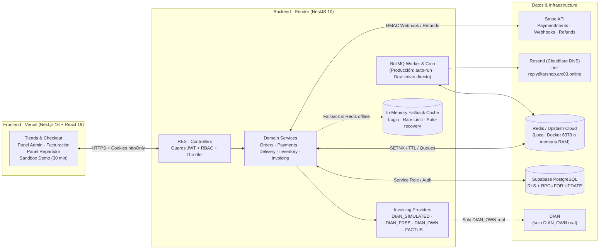
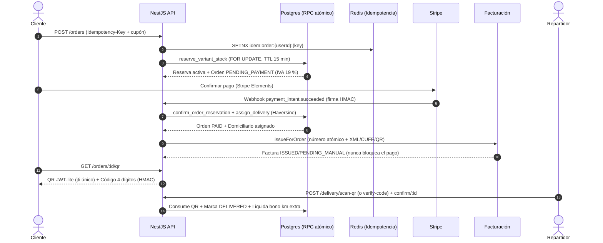

# ARShop — E-Commerce & Last-Mile Logistics Platform

> **"Moda oculta, sin sede física."**

Plataforma full-stack de comercio electrónico y logística de última milla para moda minimalista en Colombia. Combina garantías transaccionales de grado bancario, reservas de inventario con bloqueo pesimista (`FOR UPDATE`), verificación criptográfica de entregas con QR dinámico (`JWT-lite` + `HMAC`), facturación electrónica DIAN simulada en ambiente de habilitación y cumplimiento normativo colombiano (**Ley 1480**, **Ley 1581** e IVA 19 %).

**Estado:** portafolio funcional end-to-end. Backend NestJS 10, frontend Next.js 16, Supabase/PostgreSQL, Stripe, Redis/BullMQ, Resend y facturación DIAN en modo demostración. La suite actual tiene **19 suites y 90 pruebas** (unitarias + E2E HTTP).

> [!IMPORTANT]
> **Cambio planificado — parche v1.1: se retiran Redis y BullMQ.**
> La versión actual (v1.0) todavía los usa para colas de correo, indexación de catálogo y caché compartida. En **v1.1** se eliminan por completo porque generaban **consultas innecesarias** (casi todas terminaban cayendo al fallback) y **superaban el límite de peticiones gratuitas** del proveedor de Redis. Detalle y alcance en [Cambios planificados: retiro de Redis y BullMQ](#cambios-planificados--v11-retiro-de-redis-y-bullmq).


---

## Inicio rápido

### Requisitos

| Herramienta | Versión / nota |
|---|---|
| **Node.js** | 20 o superior (el CI usa Node 22) |
| **pnpm** | 11 (`corepack enable` o `npm i -g pnpm`) |
| **Docker Desktop** | Opcional. Sólo para levantar Redis local; sin Docker el backend usa el fallback en memoria. |
| **Supabase** | Proyecto con las migraciones aplicadas. |
| **Stripe** | Cuenta en modo test y sus claves. |
| **Resend** | API key y remitente (necesarios para que el backend arranque). |

### 1. Clonar e instalar

```bash
git clone https://github.com/aruiz3122004/arshop.git
cd arshop
pnpm install
```

### 2. Configurar variables de entorno

```bash
cp backend/.env.example backend/.env
cp apps/web/.env.example apps/web/.env.local
```

En PowerShell:

```powershell
Copy-Item backend/.env.example backend/.env
Copy-Item apps/web/.env.example apps/web/.env.local
```

Completa como mínimo las credenciales de **Supabase**, **Stripe** y **Resend** en `backend/.env`, y las claves públicas en `apps/web/.env.local`. El detalle está en [Variables de entorno](#variables-de-entorno).

> Los archivos `.env` están en `.gitignore`. Nunca los subas al repositorio.

### 3. Preparar la base de datos

En una base nueva, aplica el esquema base y después **todas** las migraciones en orden numérico. Las migraciones son idempotentes. `DATABASE_URL` es la cadena de conexión directa de Postgres (Supabase → *Settings → Database*), no la URL de la API.

```bash
psql "$DATABASE_URL" -f db/schema.sql
psql "$DATABASE_URL" -f db/functions.sql
psql "$DATABASE_URL" -f db/rls.sql
psql "$DATABASE_URL" -f db/data/co_city_centroids.sql

for f in $(ls db/migrations/[0-9]*.sql | sort); do
  psql "$DATABASE_URL" -f "$f"
done

psql "$DATABASE_URL" -f db/seed.sql   # opcional: catálogo de ejemplo
```

En PowerShell:

```powershell
psql $env:DATABASE_URL -f db/schema.sql
psql $env:DATABASE_URL -f db/functions.sql
psql $env:DATABASE_URL -f db/rls.sql
psql $env:DATABASE_URL -f db/data/co_city_centroids.sql

Get-ChildItem db/migrations/[0-9]*.sql | Sort-Object Name | ForEach-Object {
  psql $env:DATABASE_URL -f $_.FullName
}

psql $env:DATABASE_URL -f db/seed.sql   # opcional
```

También puedes pegar cada archivo en el **SQL Editor** de Supabase. El rango actual de migraciones es **001–030** (004–009 están reservadas y no existen). Después promueve al menos un administrador:

```sql
update public.profiles set role = 'ADMIN' where id = '<uuid>';
```

Más detalle en [`db/README.md`](./db/README.md).

### 4. Arrancar frontend y backend

```bash
pnpm dev:all
```

El comando comprueba si Docker está activo; si lo está, levanta Redis (`arshop-redis`, puerto `6379`) y arranca frontend y backend en paralelo. Si no hay Docker, el backend continúa con el fallback en memoria.

| Servicio | URL |
|---|---|
| Frontend | `http://localhost:3000` |
| Backend API | `http://localhost:4000` |
| Health check | `http://localhost:4000/health` |

### 5. Probar el flujo

- Entra a [`/cuenta`](http://localhost:3000/cuenta) y usa el **Modo Demo Portafolio** para recorrer los 3 roles sin configurar Supabase.
- Para el flujo real: regístrate, verifica el correo, agrega productos y paga con la tarjeta de prueba `4242 4242 4242 4242`.
- Para el webhook local:

  ```bash
  stripe listen --forward-to localhost:4000/payments/webhook
  ```

  Copia el `whsec_...` que imprime el CLI a `STRIPE_WEBHOOK_SECRET` en `backend/.env`.

### Comandos útiles

| Comando | Qué hace |
|---|---|
| `pnpm dev:all` | Redis (si hay Docker) + frontend + backend. |
| `pnpm dev` / `pnpm dev:web` | Sólo el frontend. |
| `pnpm dev:backend` | Sólo el backend. |
| `pnpm build` | Build de todos los paquetes. |
| `pnpm start` | Sirve el frontend ya compilado. |
| `pnpm --filter @arshop/api test` | Suite Jest + Supertest del backend. |
| `pnpm --filter @arshop/api typecheck` | TypeScript del backend. |
| `pnpm --filter @arshop/web exec tsc --noEmit` | TypeScript del frontend. |

---

## Modo demo portafolio

En [`/cuenta`](./apps/web/src/app/cuenta/page.tsx) existe el bloque **Modo Demo Portafolio · Acceso 1-Clic**, que aprovisiona e inicia sesión al instante en cualquiera de los 3 roles sin tocar la base de datos real:

| Rol | Cuenta demo | Qué puedes probar |
|---|---|---|
| **Cliente** | `demo.cliente@arshop.co` | Catálogo con filtros y buscador con sinónimos colombianos, guía de tallas interactiva, cupones (`BIENVENIDO10`, `DROP15`, `ARSHOP30K`), checkout idempotente con Stripe, QR de recepción, cancelación pre-envío, comprobante de pedido y solicitudes de retracto/cambio de talla (Ley 1480). |
| **Admin** | `demo.admin@arshop.co` | CRUD de productos y variantes, ventanas de lanzamiento (*drops*), motor de búsqueda aislado, despacho con transportadora nacional o asignación de domiciliario, arbitraje de disputas, resolución de RMA con reembolso automático y facturación electrónica simulada. |
| **Repartidor** | `demo.repartidor@arshop.co` | Panel de entregas (`/domiciliario`), escáner de QR con cámara, validación de código numérico de 4 dígitos con protección brute-force, entrega simulada protegida por PIN y billetera de bonos por kilometraje extra. |

**Garantías del sandbox:**

- **Cero contacto con la base real**: el modo demo corre sobre una base reactiva en memoria en el cliente ([`demo-store.ts`](./apps/web/src/lib/demo-store.ts)). Las mutaciones persisten en `sessionStorage` y se resetean al salir.
- **Sesión temporal de 30 minutos**: el widget flotante ([`demo-banner.tsx`](./apps/web/src/components/demo-banner.tsx)) muestra la cuenta regresiva y permite *"Reiniciar datos"* o *"Salir del modo demo"*.
- **Protección backend**: `DEMO_MODE_DISABLED=true` en producción impide que las llamadas demo contaminen usuarios o tablas en Supabase.

---

## Qué incluye la plataforma

### Visitante

- Home editorial con catálogo segmentado por género y categoría.
- Filtros por talla, color, precio y disponibilidad; búsqueda con sinónimos colombianos.
- Guía de tallas interactiva, selector de moneda (COP/USD/EUR) y páginas legales.
- Ficha de producto con datos estructurados Schema.org (`Product` JSON-LD), reseñas verificadas y promedio de estrellas.
- Compra sin cuenta (*guest checkout*): el carrito no exige login y el seguimiento llega por enlace firmado al correo.
- PWA instalable, sitemap y robots.

### Cliente

- Registro con verificación de correo por enlace o código OTP.
- Login con cookies `httpOnly`, refresh rotation y MFA (TOTP, código por email o códigos de respaldo).
- Perfil, direcciones múltiples y dirección predeterminada.
- Carrito, cupones, checkout con Stripe Elements y captura opcional de datos de facturación.
- Historial de pedidos, detalle, QR de recepción, cancelación pre-envío y comprobante de pedido.
- Solicitudes de retracto/cambio de talla dentro de los plazos legales.
- Reseñas verificadas sobre productos comprados y reclamación de pedidos hechos como invitado.
- Notificaciones push y correos transaccionales.
- Tarjeta de factura con número, estado, CUFE y enlace público cuando existe una FEV emitida.

### Administrador

- Dashboard, CRUD de productos/variantes, imágenes, drops y exportación JSON.
- Búsqueda administrativa aislada y reindexación.
- Pedidos: despacho con transportadora o asignación de domiciliario, cancelación y reembolso.
- Usuarios: roles, bloqueos, altas masivas, MFA y auditoría.
- Domiciliarios: fichas, disponibilidad, zona, vehículo y placa.
- Disputas de entrega, devoluciones y RMA.
- Reseñas: moderación en `/admin/resenas` (aprobar u ocultar) sin borrar el histórico.
- Facturación: listado, emisión, reintentos, registro manual de CUFE, descargas XML/representación y notas crédito.
- Logs de auditoría y configuración.

### Repartidor

- Entregas asignadas, detalle del pedido y datos de contacto del cliente.
- Escaneo de QR con cámara o ingreso manual del código de 4 dígitos.
- Entrega simulada con PIN personal o declaración auditada (`skipPin`), sin autoaceptar el pedido.
- Billetera de bonos por kilómetro extra.
- Configuración de zona (departamento/ciudad con dropdowns), vehículo, placa, PIN y push.

---

## Arquitectura del sistema



> La flecha punteada de proveedores hacia la DIAN sólo aplica al adaptador real `DIAN_OWN`. El modo por defecto (`DIAN_SIMULATED`) genera todo localmente y no transmite.

---

## Flujo transaccional



**Regla de oro:** la facturación y las notificaciones son efectos secundarios. Si fallan, la orden sigue `PAID` y queda pendiente de reintento; nunca se revierte un pago por un fallo de la DIAN o del correo.

---

## Autenticación, MFA y seguridad

- **Sesión con cookies `httpOnly`**: el frontend no guarda tokens en `localStorage`; el navegador habla a `/api/*` (same-origin) y Next reescribe al backend. El header `Authorization: Bearer` sigue aceptándose para clientes antiguos.
- **Refresh transparente en servidor**: si el `access_token` (1 h) expiró pero el `refresh_token` (30 días) sigue vigente, el guard renueva la sesión dentro de la misma request y reescribe las cookies. El usuario no ve un 401 ni un logout inesperado.
- **Refresh rotation con gracia y deduplicación**: los refresh simultáneos del mismo token se agrupan en una sola llamada a Supabase y la nueva pareja se reutiliza durante 60 s, evitando la revocación por reutilización de refresh tokens.
- **Verificación local de JWT**: el guard valida HS256 con `SUPABASE_JWT_SECRET` y soporta claves asimétricas **ES256 vía JWKS** de Supabase. Si la validación local falla por una razón distinta a expiración, cae al endpoint remoto de Supabase.
- **MFA**: TOTP con `speakeasy`/`qrcode`, código por email, códigos de respaldo y modal post-login ([`auth-mfa.controller.ts`](./backend/src/modules/auth/auth-mfa.controller.ts)).
- **Sesión MFA tolerante a reinicios**: la sesión pendiente dura 15 minutos y viaja cifrada con **AES-256-GCM** dentro del propio `sessionId`, además de Redis/memoria. Un cold start de Render o un reinicio de `nest --watch` no invalida el login en curso.
- **Correo MFA directo**: el código 2FA se envía por Resend sin pasar por BullMQ, porque el usuario está esperando bloqueado en el modal.
- **Lockout**: 5 intentos fallidos por email durante 15 minutos, además del throttle por IP (5 req/min en `/auth/sign-in` y `/orders`).
- **Verificación de correo por Resend**: con `REQUIRE_EMAIL_VERIFY=true`, la cuenta queda sin confirmar hasta validar el correo. El enlace y el código OTP los envía la API con plantilla propia ([`auth-verify.ts`](./backend/src/modules/notifications/templates/auth-verify.ts)), nunca el mailer interno de Supabase. Se confirma en [`/verificar`](./apps/web/src/app/verificar/page.tsx) por enlace o código, y se reenvía en [`/verificar/reenviar`](./apps/web/src/app/verificar/reenviar/page.tsx).
- **Recuperación de contraseña**: enlace generado por la API y enviado por Resend con [`auth-recovery.ts`](./backend/src/modules/notifications/templates/auth-recovery.ts); si falla, cae al mailer de Supabase para no romper el flujo.
- **RLS y revocación de escrituras directas**: [`026_delivery_role_sync.sql`](./db/migrations/026_delivery_role_sync.sql) revoca `UPDATE` sobre `profiles` a `anon`/`authenticated`; [`027_revoke_client_order_writes.sql`](./db/migrations/027_revoke_client_order_writes.sql) revoca `UPDATE` sobre `orders`. El navegador nunca escribe directo en Supabase.
- **Cabeceras de seguridad**: `next.config.mjs` emite `Content-Security-Policy` con allowlist explícita (Stripe, Google Fonts, Supabase Storage, Unsplash), `X-Frame-Options`, `Referrer-Policy`, `Permissions-Policy` (`camera=(self)` para el escáner) y HSTS en producción.
- **Gate de rutas privadas antes del render**: [`proxy.ts`](./apps/web/src/proxy.ts) corta `/admin`, `/domiciliario` y `/cuenta/pedidos/*` si no hay cookie de sesión. La autorización real sigue en el `RolesGuard` del backend.
- **Secretos fuera del cliente**: certificados y claves de facturación viven sólo en el backend; los logs redactan campos sensibles.

---

## Inventario, pagos y prevención de sobreventa

- **Reserva temporal con bloqueo de fila (`FOR UPDATE`)**: al iniciar el checkout, `reserve_variant_stock` ([`017_stock_reservations.sql`](./db/migrations/017_stock_reservations.sql)) bloquea las filas de `product_variants`, descuenta las reservas activas de otros usuarios y crea un bloqueo de 15 minutos.
- **Limpieza distribuida y pago tardío**: un cronjob con lock distribuido en Redis ([`ReservationsCleanupService`](./backend/src/modules/inventory/reservations-cleanup.service.ts)) libera reservas vencidas, marca órdenes abandonadas como `CANCELLED` y cancela sus `PaymentIntents` huérfanos. Si un webhook tardío llega después de expirar la reserva ([`023_fix_logical_gaps.sql`](./db/migrations/023_fix_logical_gaps.sql)), el sistema verifica stock físico disponible o emite un **auto-reembolso inmediato en Stripe** si otro comprador agotó la última unidad.
- **Pago idempotente**: `POST /orders` ([`orders.controller.ts`](./backend/src/modules/orders/orders.controller.ts)) usa `Idempotency-Key` respaldada por `SETNX` en Redis, con *polling* para peticiones concurrentes. Evita pedidos duplicados por doble clic o reintentos de red.
- **Webhooks verificados**: Stripe valida la firma HMAC y la transición real de estado (`PENDING_PAYMENT → PAID`) antes de ejecutar efectos secundarios. Reintentar el webhook no duplica reembolsos ni notas crédito.
- **Asignación geográfica multicapa**: la RPC `assign_delivery` ([`023_fix_logical_gaps.sql`](./db/migrations/023_fix_logical_gaps.sql)) busca primero un repartidor disponible en la misma ciudad (`ASSIGNED`) balanceando por menor carga de pedidos activos (`FOR UPDATE SKIP LOCKED`), o reasigna al repartidor más cercano del departamento usando **Haversine** (`REASSIGNED_DEPT`), con bono por kilómetro extra y tope operativo de 80 km.

---

## Logística y entrega verificada

- **Antifraude en última milla**: un repartidor sólo puede marcar un pedido como `DELIVERED` si consumió previamente el **QR firmado (`jti`)** o verificó el **código de 4 dígitos** del cliente ([`delivery.service.ts`](./backend/src/modules/delivery/delivery.service.ts)).
- **Código sin abrir el pedido**: `POST /delivery/verify-code` resuelve la orden comparando el hash —que incluye su id— entre las entregas activas del repartidor. Un código sólo puede consumir la orden a la que pertenece.
- **Entrega simulada**: exige los datos del receptor y, o bien el PIN personal del repartidor (`scrypt`, bloqueo tras 5 intentos), o una declaración explícita de que no lo tiene a mano (`skipPin`, auditada). El pedido **no** pasa a `DELIVERED`: queda en `PENDING_CLIENT`, recibe push, recordatorio a las 24 h y, si no responde en 48 h, escala a `DISPUTED` para arbitraje administrativo ([`delivery-confirmation.service.ts`](./backend/src/modules/delivery/delivery-confirmation.service.ts)).
- **Despacho por transportadora nacional**: soporte para guías de *Servientrega, Coordinadora, Interrapidísimo, TCC y Envía* con enlace de rastreo.
- **Rol `REPARTIDOR` ↔ tabla `domiciliarios`**: [`026_delivery_role_sync.sql`](./db/migrations/026_delivery_role_sync.sql) sincroniza ambos caminos con triggers. Dejar de ser repartidor sólo marca `INACTIVO` para conservar historial de entregas y bonos.
- **Zona con dropdowns**: `departamento` y `ciudad` se alimentan del diccionario [`colombia.ts`](./apps/web/src/lib/colombia.ts) (33 departamentos + Bogotá D.C. y sus municipios).

---

## Devoluciones, retracto y cumplimiento

- **Derecho de retracto y RMA (Ley 1480 Art. 47)**: motor de devoluciones ([`orders.service.ts`](./backend/src/modules/orders/orders.service.ts)) que calcula **días hábiles** desde `delivered_at` (máx. 5 días hábiles para retracto o cambio de talla; 30 días calendario para garantía por defecto de calidad) y permite al administrador aprobar cambios o disparar el reembolso total en Stripe + reposición de stock.
- **Cancelación voluntaria pre-envío**: cliente y admin pueden cancelar órdenes en `PENDING_PAYMENT` (libera reserva) o en `PAID` antes de ser enviadas (reembolso automático en Stripe + restauración de stock + alertas *Back-in-Stock*).
- **Nota crédito automática**: si la orden reembolsada ya tenía factura `ISSUED`, se emite la nota crédito correspondiente.
- **Desglose tributario (IVA 19 %)**: base gravable sin IVA, impuesto incluido y descuentos por cupón, con comprobante de pedido imprimible.
- **Habeas Data**: tratamiento de datos conforme a Ley 1581, con página de privacidad y consentimiento en checkout.

---

## Facturación electrónica DIAN

> **Estado actual:** implementada en modo **demostración**. El proveedor por defecto es `DIAN_SIMULATED` en ambiente `HABILITACION`: genera XML UBL 2.1, CUFE SHA-384, QR y representación imprimible, y simula una aceptación. **No firma con certificado real ni transmite a la DIAN.**

El análisis legal y de diseño completo está en [`docs/FACTURACION_DIAN.md`](./docs/FACTURACION_DIAN.md).

| Proveedor | Comportamiento actual | Uso previsto |
|---|---|---|
| `DIAN_SIMULATED` | Genera XML/CUFE/QR y responde `ISSUED` con track de habilitación simulado. | Demos y pruebas end-to-end (valor por defecto). |
| `DIAN_FREE` | Genera el XML y deja la factura en `PENDING_MANUAL`. | Radicación manual en el portal DIAN y registro posterior de número/CUFE. |
| `DIAN_OWN` | Genera XML local y responde `FAILED` con mensaje de configuración. | Adaptador `@dian-kit` con certificado `.p12`, software ID/PIN y habilitación real. |
| `FACTUS` | Genera XML local y responde `FAILED` con mensaje de configuración. | Integración REST con un proveedor tecnológico pago. |

**Estados:** `PENDING`, `PENDING_MANUAL`, `ISSUED`, `REJECTED`, `FAILED`, `VOID`.

**Flujo de emisión:**

1. El webhook de Stripe confirma el pago y deja la orden `PAID` (o el admin usa `dev/simulate-paid`).
2. `InvoicingService.issueForOrder()` verifica que la orden sea facturable (`PAID`, `SHIPPED` o `DELIVERED`).
3. `InvoiceNumberingService` asigna el siguiente consecutivo con la RPC `next_invoice_number` (`FOR UPDATE`) y fallback optimista.
4. Se construye el borrador fiscal: comprador, líneas, descuento prorrateado, IVA, envío y totales en COP.
5. El proveedor genera XML UBL 2.1, CUFE SHA-384, QR y (si aplica) representación.
6. Se guardan `invoices`, `invoice_lines`, `invoice_events` y se encola el correo `invoice-issued`.
7. Si la orden se reembolsa o se aprueba un RMA, se emite **nota crédito** automática cuando existe una factura `ISSUED`.

La emisión es idempotente: `unique(order_id)`, reutilización del número en reintentos y `jobId` determinista para el correo. Un número aceptado no se reutiliza.

**Modelo de datos (migración `028`):** `company_fiscal_settings`, `invoice_numbering_ranges`, `invoices`, `invoice_lines`, `invoice_events`, `credit_notes`, columnas fiscales en `orders` (`billing_*`, `invoice_status`, `taxable_base_cop`, `shipping_tax_cop`).

**Interfaz:** `/admin/facturacion`, `/admin/facturacion/[id]`, `/admin/facturacion/configuracion`, columna "Factura" en `/admin/pedidos`, tarjeta de factura en `/cuenta/pedidos/[id]` y captura opcional de datos fiscales en checkout.

> El comprobante HTML del detalle del pedido se llama **"Comprobante de Pedido"** y no debe presentarse como factura DIAN. La representación gráfica de la FEV es un documento distinto, disponible sólo cuando la factura está `ISSUED`.

**Pendiente para producción real:** adaptador `dian-kit` (firma XAdES-EPES, SOAP, certificado `.p12`), captura cifrada de certificado/Software ID/PIN, pruebas contra el sandbox DIAN, numeración autorizada real, nota débito, contingencia, retención documental y validación con contador público.

---

## Búsqueda, catálogo y moneda

- **Motor full-text**: [`ElasticsearchService`](./backend/src/modules/search/elasticsearch.service.ts) usa Elasticsearch si `ELASTICSEARCH_NODE` está configurado y cae a un motor full-text aislado en memoria si no.
- **Búsqueda con sinónimos colombianos** y resaltado de coincidencias; historial reciente en el overlay.
- **Panel de productos**: CRUD, variantes, imágenes con signed URL, drops (`drop_starts_at`/`drop_ends_at`), exportación JSON y reindexación administrativa.
- **Sincronización resiliente**: si BullMQ/Redis no está disponible, la indexación se ejecuta en el mismo proceso en lugar de perderse ([`catalog-sync.service.ts`](./backend/src/modules/search/catalog-sync.service.ts)).
- **Multimoneda**: COP/USD/EUR con tasas de cambio desde el backend ([`exchange-rates`](./backend/src/modules/exchange-rates/exchange-rates.controller.ts)); la tienda muestra el precio convertido, pero la orden y la factura conservan COP.
- **Back-in-stock**: suscripciones por variante y aviso automático cuando se repone stock.

---

## Resiliencia e infraestructura

- **Redis con fallback en memoria** *(se retira en v1.1, ver [cambios planificados](#cambios-planificados--v11-retiro-de-redis-y-bullmq))*: [`RedisService`](./backend/src/redis/redis.service.ts) mantiene un caché interno y conmuta a memoria si Redis está apagado, no está listo o excede cuota. Usa `enableOfflineQueue: false` para no acumular comandos cuando la conexión está caída.
- **Colas con envío directo**: los procesadores ([`email.processor.ts`](./backend/src/modules/notifications/processors/email.processor.ts), [`delivery-day.processor.ts`](./backend/src/modules/notifications/processors/delivery-day.processor.ts), [`catalog-sync.processor.ts`](./backend/src/modules/search/catalog-sync.processor.ts)) usan `autorun: process.env.NODE_ENV === "production"`. En producción encolan con timeout de 1,5 s; si Redis no responde, el correo se envía directo por Resend y la indexación corre inline. En desarrollo nunca hace falta Redis para probar esos flujos.
- **Correos verificados (Cloudflare + Resend)**: subdominio firmado `arshop.arc03.online` con DKIM, SPF y DMARC en modo *DNS Only*. Detalle en [`docs/EMAILS.md`](./docs/EMAILS.md).
- **Arranque en frío del backend (Render free)**: el plan gratuito duerme la instancia a los 15 min y tarda 20-50 s en despertar. Una cookie testigo, el último perfil cacheado y un `GET /health` disparado durante el parseo del HTML resuelven la vista al instante; un cron de GitHub Actions mantiene la instancia caliente. Detalle en [`docs/PERFORMANCE.md`](./docs/PERFORMANCE.md).
- **Logging estructurado JSON (Pino)**: [`PinoJsonLogger`](./backend/src/common/logger/pino-json.logger.ts) y [`LoggingInterceptor`](./backend/src/common/interceptors/logging.interceptor.ts) emiten NDJSON con `reqId` (`x-request-id`), método, URL sanitizada, status, duración y redacción de campos sensibles.

---

## Frontend y UX

- **Checkout móvil**: el cupón se canjea antes de pagar, en el formulario del paso 1, para que el comprador vea el descuento antes de comprometerse.
- **Sin desbordes horizontales**: inputs de cupón, correos largos y textos sin espacios llevan `min-w-0`/`break-all`. Medido con navegador headless (CDP) a 360/390/768/1280 px: `scrollWidth === innerWidth`.
- **Cierre de pago con navegación completa**: al confirmar el pago se usa `window.location.assign` hacia `/checkout/success` para desmontar los overlays de Stripe.js; el carrito se vacía de forma síncrona en `localStorage`.
- **Design system editorial "White-Cube Gallery"**: paleta monocromática, bordes rectos, cero sombras y tipografía como estructura. Ver [`DESIGN.md`](./DESIGN.md).
- **PWA**: manifest, service worker, instalación y opt-in a push.
- **Renovación proactiva de sesión**: el frontend renueva la sesión cada 45 minutos mientras haya usuario activo y reutiliza refresh exitosos recientes para evitar tormentas de requests.
- **Demo banner**: sesión temporal de 30 min con cuenta regresiva, reinicio de datos y salida.

---

## Stack tecnológico

**Frontend:** Next.js 16.4 (App Router) · React 19 · Tailwind CSS v4 · Stripe Elements · `@zxing/browser` (escáner QR) · `qrcode` · Lucide.

**Backend:** NestJS 10 · Supabase (Postgres + Auth + Storage) · Stripe · BullMQ/Bull con Redis o fallback en memoria · Resend · Web Push (VAPID) · Pino · Zod + class-validator · `speakeasy` (TOTP).

**Datos:** PostgreSQL 15+ en Supabase, migraciones versionadas `001-030`, RPCs atómicas, RLS y triggers.

**Infra:** Vercel (frontend) · Render (API + worker) · Upstash/Redis · Cloudflare DNS.

**Monorepo:** pnpm workspaces (`apps/*` y `backend`).

---

## Estructura del repositorio

```text
arshop/
├── apps/web/                        → Frontend Next.js 16 (App Router) · React 19 · Tailwind v4
│   ├── src/app/                     → Rutas: cada carpeta es una URL
│   │   ├── page.tsx                 → Home + catálogo con filtros
│   │   ├── product/[slug]/          → Ficha de producto (JSON-LD Schema.org)
│   │   ├── [gender]/                → Catálogo segmentado (hombre / mujer)
│   │   ├── cart/  checkout/         → Carrito y pago (Stripe Elements, success)
│   │   ├── cuenta/                  → Cuenta del cliente
│   │   │   └── pedidos/             → Historial, detalle, QR de recepción y factura
│   │   ├── admin/                   → Panel admin
│   │   │   ├── pedidos/  productos/ → Despacho, asignación, CRUD de catálogo
│   │   │   ├── facturacion/         → Listado, detalle y configuración fiscal DIAN
│   │   │   ├── usuarios/            → Roles, bloqueos, altas
│   │   │   ├── domiciliarios/       → Fichas de repartidores y disponibilidad
│   │   │   ├── resenas/             → Moderación de reseñas
│   │   │   └── disputas/ settings/ logs/
│   │   ├── domiciliario/            → Panel repartidor
│   │   │   ├── pedidos/  scan/      → Entregas, escáner QR y código de 4 dígitos
│   │   │   ├── bonos/               → Billetera de bonos por km extra
│   │   │   └── configuracion/       → Zona, vehículo, placa, PIN, push
│   │   ├── pedido/[token]/          → Seguimiento público de invitado
│   │   ├── verificar/               → Confirmación de correo (link + OTP)
│   │   ├── recuperar/               → Recuperación de contraseña
│   │   ├── atencion/ compania/ privacidad/ → Páginas editoriales y legales
│   │   └── sitemap.ts robots.ts     → SEO técnico
│   ├── src/components/              → UI reutilizable: header, footer, product-*, filter-bar,
│   │                                  address-manager, mfa-*, push-opt-in, demo-banner…
│   ├── src/lib/                     → Lógica de cliente
│   │   ├── api.ts                   → Cliente HTTP tipado; única puerta al backend
│   │   ├── auth.tsx  cart.tsx  currency.tsx  gender.tsx  location.tsx → Contextos
│   │   ├── colombia.ts              → Diccionario departamentos/ciudades
│   │   ├── catalog.ts  filters.ts  search.ts → Catálogo, filtros y sinónimos
│   │   ├── demo-store.ts            → Sandbox del modo demo (sessionStorage)
│   │   └── session-cache.ts  backend-warmup.ts → Sesión instantánea y warm-up
│   ├── src/proxy.ts                 → Gate de rutas privadas antes del render
│   ├── public/                      → Manifest, service worker, iconos e imágenes
│   └── .env.example                 → Variables del frontend
│
├── backend/                         → API NestJS 10
│   ├── src/
│   │   ├── modules/                 → Un módulo por dominio
│   │   │   ├── auth/                → Login, cookies httpOnly, refresh, MFA, verify/resend
│   │   │   ├── users/               → Perfiles, direcciones, CRUD admin de usuarios
│   │   │   ├── products/            → Catálogo, variantes, drops, imágenes
│   │   │   ├── orders/              → Checkout, estados, RMA/retracto (Ley 1480)
│   │   │   ├── payments/            → Stripe: PaymentIntents, webhooks, reembolsos
│   │   │   ├── inventory/           → Reservas FOR UPDATE + cron de liberación
│   │   │   ├── delivery/            → QR/PIN, bonos, asignación, provisioning
│   │   │   ├── invoicing/           → DIAN: emisión, numeración, XML/CUFE, notas crédito
│   │   │   ├── notifications/       → BullMQ + Resend (templates/ y processors/)
│   │   │   ├── reviews/             → Reseñas verificadas y moderación
│   │   │   ├── guest/               → Tokens HMAC para compras sin cuenta
│   │   │   ├── push/                → Web Push (VAPID)
│   │   │   └── qr/ search/ uploads/ exchange-rates/ audit-logs/ health/
│   │   ├── common/                  → decorators, guards (JWT/RBAC), filters,
│   │   │                              interceptors, logger Pino, types
│   │   ├── config/                  → Validación Zod de variables de entorno
│   │   ├── supabase/                → Cliente admin (service_role) + Auth
│   │   └── redis/                   → Caché y rate limit con fallback a memoria
│   ├── test/                        → Jest + Supertest (19 suites, 90 pruebas)
│   └── .env.example                 → Variables del backend
│
├── db/
│   ├── schema.sql                   → Esquema base reproducible
│   ├── functions.sql                → Funciones/RPCs base
│   ├── rls.sql                      → Políticas de fila
│   ├── seed.sql                     → Datos de ejemplo
│   ├── data/co_city_centroids.sql   → Centroides para asignación de repartidores
│   └── migrations/                  → SQL versionado 001-030 (tablas, RLS, triggers, RPCs)
│
├── docs/                            → EMAILS.md · PERFORMANCE.md · FACTURACION_DIAN.md
├── scripts/                         → start-docker-redis.mjs (infra local)
├── DESIGN.md                        → Sistema de diseño editorial ("White-Cube Gallery")
├── pnpm-workspace.yaml              → Monorepo gestionado con pnpm
└── package.json                     → Scripts raíz (`dev:all`, `build`, etc.)
```

---

## Dónde tocar cada cosa

| Si quieres cambiar… | Ve a |
|---|---|
| Una pantalla, un texto o un formulario | `apps/web/src/app/<ruta>/page.tsx` |
| Un componente reutilizable (header, cards, modales) | `apps/web/src/components/` |
| Una llamada al backend o un tipo compartido | `apps/web/src/lib/api.ts` |
| Departamentos/ciudades de un dropdown | `apps/web/src/lib/colombia.ts` |
| Etiquetas o colores de estados de factura | `apps/web/src/lib/invoicing-display.ts` |
| Reglas de negocio, validaciones o permisos | `backend/src/modules/<dominio>/` |
| Emisión, XML, CUFE o notas crédito | `backend/src/modules/invoicing/` |
| Reseñas verificadas o moderación | `backend/src/modules/reviews/` · `apps/web/src/app/admin/resenas/` |
| Token, rutas y seguimiento de invitado | `backend/src/modules/guest/` · `apps/web/src/app/pedido/` |
| Un correo transaccional | `backend/src/modules/notifications/templates/` |
| Guards, decoradores o manejo global de errores | `backend/src/common/` |
| Tablas, políticas RLS, triggers o RPCs | `db/migrations/` (nueva migración numerada) |
| Variables de entorno requeridas | `backend/src/config/env.validation.ts` |
| Configuración fiscal del emisor | `/admin/facturacion/configuracion` |

---

## Variables de entorno

> Nunca commitees `.env`, `.env.local` ni `backend/.env`. El `.gitignore` los excluye. Si una credencial se filtró, rótala y purga el historial del repositorio.

### Backend (`backend/.env`)

Fuente de verdad: [`backend/.env.example`](./backend/.env.example) y [`env.validation.ts`](./backend/src/config/env.validation.ts).

| Grupo | Variables |
|---|---|
| Runtime | `NODE_ENV`, `PORT`, `CORS_ORIGIN`, `APP_URL`, `REQUIRE_EMAIL_VERIFY` |
| Supabase | `SUPABASE_URL`, `SUPABASE_ANON_KEY`, `SUPABASE_SERVICE_ROLE_KEY`, `SUPABASE_JWT_SECRET` |
| Stripe | `STRIPE_SECRET_KEY`, `STRIPE_WEBHOOK_SECRET`, `STRIPE_CURRENCY` |
| Resend | `RESEND_API_KEY`, `RESEND_FROM`, `RESEND_SANDBOX_TO` |
| Redis | `REDIS_HOST`, `REDIS_PORT`, `REDIS_PASSWORD`, `REDIS_TLS` |
| Rate limiting | `THROTTLE_TTL_SECONDS`, `THROTTLE_LIMIT_DEFAULT`, `THROTTLE_LIMIT_STRICT` |
| Setup | `ADMIN_SETUP_TOKEN` |
| Demo | `DEMO_MODE_DISABLED` (obligatorio en producción) |
| Entregas | `SIMULATED_DELIVERY_HOURS`, `SIMULATED_DELIVERY_REMINDER_HOURS`, `DELIVERY_BONUS_BASE_COP`, `DELIVERY_FREE_RADIUS_KM`, `QR_TTL_SECONDS`, `CLIENT_CODE_TTL_SECONDS` |
| Web Push | `VAPID_PUBLIC_KEY`, `VAPID_PRIVATE_KEY`, `VAPID_SUBJECT` |
| Búsqueda | `ELASTICSEARCH_NODE`, `ELASTICSEARCH_INDEX`, `ELASTICSEARCH_API_KEY`, `ELASTICSEARCH_USERNAME`, `ELASTICSEARCH_PASSWORD` |
| QR / facturación / invitado | `QR_HMAC_SECRET` (firma QR de entrega), `INVOICE_PUBLIC_SECRET` (firma enlaces públicos de facturas), `GUEST_ORDER_SECRET` y `GUEST_ORDER_TTL_SECONDS` (enlaces de seguimiento de invitado) |

Notas:

- `QR_HMAC_SECRET` es obligatorio en producción y debe tener al menos 32 caracteres. El valor de desarrollo hace fallar el arranque en producción.
- `INVOICE_PUBLIC_SECRET` y `GUEST_ORDER_SECRET` son opcionales: si se omiten, reutilizan `QR_HMAC_SECRET`. Definirlos permite rotar enlaces sin invalidar los QR de entrega.
- El TTL por defecto de los enlaces de invitado es de 30 días (`2592000` segundos). El token no se persiste: la firma HMAC es la única credencial.

### Frontend (`apps/web/.env.local`)

Fuente de verdad: [`apps/web/.env.example`](./apps/web/.env.example).

| Variable | Uso |
|---|---|
| `BACKEND_URL` | URL del backend para rewrites server-side (`http://localhost:4000` en local). |
| `NEXT_PUBLIC_SUPABASE_URL` | URL pública de Supabase. |
| `NEXT_PUBLIC_SUPABASE_ANON_KEY` | Anon key pública (nunca la `service_role`). |
| `NEXT_PUBLIC_STRIPE_PUBLISHABLE_KEY` | Publishable key de Stripe. |

---

## Pruebas

```bash
pnpm --filter @arshop/api test
```

Estado actual: **19 suites · 90 pruebas**.

| Suite | Qué verifica |
|---|---|
| [`critical-flows.e2e.spec.ts`](./backend/test/critical-flows.e2e.spec.ts) | Flujos E2E HTTP: signup → login con cookies → cupón → checkout idempotente; PaymentIntent → webhook HMAC → PAID; QR → bloqueo sin QR → entrega → RMA. |
| [`invoicing.spec.ts`](./backend/test/invoicing.spec.ts) | Emisión simulada, numeración atómica, XML/CUFE, estados, notas crédito, enlace público y facturación automática. |
| [`logical-gaps.spec.ts`](./backend/test/logical-gaps.spec.ts) | Limpieza de reservas expiradas, bloqueo de confirmación manual sin QR/código, asignación diferida a `PAID` y rescate de `UNASSIGNED`. |
| [`commercial-gaps.spec.ts`](./backend/test/commercial-gaps.spec.ts) | Cupones, cancelación pre-envío con reembolso, 5 días hábiles (Ley 1480), guías de transportadora e IVA 19 %. |
| [`auth-lockout.spec.ts`](./backend/test/auth-lockout.spec.ts) | Lockout de login tras intentos fallidos. |
| [`verify-code-lockout.spec.ts`](./backend/test/verify-code-lockout.spec.ts) | Protección brute-force del código de entrega de 4 dígitos. |
| [`verify-code-anywhere.spec.ts`](./backend/test/verify-code-anywhere.spec.ts) | Resolución del código entre entregas activas sin consumir órdenes ajenas. |
| [`issue-qr-client-code.spec.ts`](./backend/test/issue-qr-client-code.spec.ts) | El refresco del QR conserva el código vigente (`keepCode`) y sólo emite uno nuevo al expirar. |
| [`qr.service.spec.ts`](./backend/test/qr.service.spec.ts) | Firma criptográfica del QR. |
| [`notifications-idempotent.spec.ts`](./backend/test/notifications-idempotent.spec.ts) | Idempotencia en colas BullMQ. |
| [`delivery-confirmation-window.spec.ts`](./backend/test/delivery-confirmation-window.spec.ts) | Ventana 24/48 h, recordatorio push y escalado a `DISPUTED`. |
| [`delivery-simulate-guard.spec.ts`](./backend/test/delivery-simulate-guard.spec.ts) | Bloqueo de entrega simulada cuando ya existe QR o código. |
| [`addresses.service.spec.ts`](./backend/test/addresses.service.spec.ts), [`create-address.dto.spec.ts`](./backend/test/create-address.dto.spec.ts), [`update-profile.dto.spec.ts`](./backend/test/update-profile.dto.spec.ts), [`delivery-pin.dto.spec.ts`](./backend/test/delivery-pin.dto.spec.ts), [`auth-recovery-mailer.spec.ts`](./backend/test/auth-recovery-mailer.spec.ts) | Validación de direcciones, perfil, PIN/`skipPin` y correo de recuperación con Resend. |
| [`reviews.service.spec.ts`](./backend/test/reviews.service.spec.ts) | Reseñas verificadas: rechazo de pedidos no pagados, compra de otra cuenta, snapshot del autor y elegibilidad. |
| [`guest-checkout.spec.ts`](./backend/test/guest-checkout.spec.ts) | Token HMAC de invitado (firma, manipulación, expiración) y creación de orden sin `user_id`. |

---

## CI/CD, SEO y observabilidad

- **GitHub Actions CI**: [`.github/workflows/test.yml`](./.github/workflows/test.yml) ejecuta `typecheck`, `test` (unitarios + E2E) y `build` de NestJS y Next.js en cada push/PR a `main`, `master` o `develop`.
- **Keep-alive**: [`.github/workflows/keepalive.yml`](./.github/workflows/keepalive.yml) hace ping a `GET /health` cada 10 minutos usando la variable `BACKEND_HEALTH_URL`. Si no está configurada, el job termina sin error.
- **SEO técnico**: [`sitemap.ts`](./apps/web/src/app/sitemap.ts), [`robots.ts`](./apps/web/src/app/robots.ts), metadatos OpenGraph/Twitter y datos estructurados **Schema.org `Product` (JSON-LD)** en [`product/[slug]/page.tsx`](./apps/web/src/app/product/%5Bslug%5D/page.tsx).
- **Páginas editoriales y legales**: [`/atencion`](./apps/web/src/app/atencion/page.tsx) (envíos, recepción QR, devoluciones y contacto), [`/compania`](./apps/web/src/app/compania/page.tsx) (guía de compra y FAQ) y [`/privacidad`](./apps/web/src/app/privacidad/page.tsx) (Habeas Data).
- **Observabilidad**: logs NDJSON con Pino, `reqId`, duración y redacción de datos sensibles. No hay APM externo todavía (ver [Roadmap](#roadmap)).

---

## Checklist de despliegue

1. **Migraciones**: aplicar en Supabase, en orden, todas las de `db/migrations/` que falten. Este release asume el rango `001-030` aplicado.
2. **Verificación de correo (Resend)**: `REQUIRE_EMAIL_VERIFY=true`, `RESEND_API_KEY`, `RESEND_FROM` y `APP_URL` apuntando al frontend real. En Supabase → *Authentication → URL Configuration → Redirect URLs* agrega `https://<dominio>/verificar` (y `http://localhost:3000/verificar` en local) y mantén activo **Confirm email**.
3. **Variables de entorno**: `SIMULATED_DELIVERY_HOURS=48`, `SIMULATED_DELIVERY_REMINDER_HOURS=24`, `DEMO_MODE_DISABLED=true`, `QR_HMAC_SECRET` aleatorio de al menos 32 caracteres y, si se quiere push, `VAPID_PUBLIC_KEY`/`VAPID_PRIVATE_KEY`.
4. **Facturación**: `INVOICE_PUBLIC_SECRET` definido (o reutiliza `QR_HMAC_SECRET`). Entra a `/admin/facturacion/configuracion`, verifica proveedor `DIAN_SIMULATED` y ambiente `HABILITACION`, activa la facturación y usa "Probar configuración". **No cambiar a `PRODUCCION` sin un proveedor real.**
5. **Stripe**: webhook apuntando a `POST /payments/webhook` con su `STRIPE_WEBHOOK_SECRET` vigente; en sandbox, tarjeta `4242 4242 4242 4242`.
6. **Humo post-deploy**:
   - Registro → llega el correo de Resend → confirmar por enlace y por código OTP → login correcto.
   - Login → checkout completo → pago PAID → factura `ISSUED` visible en `/admin/facturacion` → descargar XML/representación.
   - Checkout como invitado → llega el correo con enlace `/pedido/:token` → abrirlo en incógnito → confirmar entrega simulada o reclamar el pedido con una cuenta del mismo correo.
   - QR en `/cuenta/pedidos/:id/qr` → simular entrega sin PIN → el pedido queda en `PENDING_CLIENT` y el cliente recibe el push para aceptar o disputar.

---

## Plan de escalabilidad

El despliegue actual corre **100 % en capas gratuitas**. Funciona para portafolio, pero tiene tres límites duros: Render duerme la instancia (20-50 s de cold start), Supabase free pausa el proyecto por inactividad y **no incluye backups**, y Vercel Hobby prohíbe el uso comercial y limita los cron a **una ejecución diaria**.

| Fase | Inversión | Qué resuelve |
|---|---|---|
| **0 — Hardening** (implementado) | $0 | CSP y security headers, gate de rutas, warm-up, keep-alive, fallback Redis → memoria, cookies `httpOnly` con refresh rotation. |
| **1 — Tienda real** | ~$59-79 USD/mes | Supabase Pro (backups diarios), Render Starter + worker (sin sleep y BullMQ en proceso aparte), Vercel Pro (uso comercial y cron por minutos), Resend Pro si se superan 3.000 correos/mes, Upstash Redis para rate limiting distribuido. |
| **2 — Escala** | ~$150-250 USD/mes | Cache de catálogo, imágenes en R2/Cloudinary, read replica + pooling, partición de `orders`, DLQ y backoff, patrón outbox, Sentry/OpenTelemetry, WAF y rate limit de borde. |
| **3 — Multi-región** | >50.000 usuarios | Réplicas por región, cache en el edge, colas regionales con idempotencia global y separación de la API pública de la administrativa. |

**Disparadores para subir de fase:** p95 del checkout > 800 ms, CPU de Postgres > 70 % sostenido, más de 100 jobs pendientes en BullMQ, 5xx > 0,5 %, cold start > 2 s, más de 3.000 correos/mes o el primer cliente real cobrando.

**Lo que deliberadamente no se haría todavía:** microservicios, Kubernetes y Kafka. Un monolito modular NestJS + un worker es la arquitectura correcta antes de tener equipos separados; partir el dominio antes sólo agrega latencia y costo operativo.

---

## Cambios planificados — v1.1: retiro de Redis y BullMQ

**Estado:** aprobado para el parche **v1.1**. La v1.0 (actual) sigue funcionando con Redis y BullMQ; el retiro se hará en la próxima entrega.

### Por qué se retiran

1. **Consultas innecesarias.** `RedisService` escribe siempre en memoria y sólo usa Redis como copia adicional; si Redis está lento, caído o sin cupo, la lectura cae al `Map` local. En la práctica, cada operación hacía hasta dos escrituras (memoria + Redis) y generaba comandos que nunca se aprovechaban.
2. **Límite de peticiones gratuitas excedido.** El plan free del Redis administrado (Upstash/Render Key Value) topó su cuota de comandos/almacenamiento. Al agotarse, Redis empieza a rechazar o limitar comandos, la aplicación entra en el fallback y queda un servicio encendido que ya no aporta nada, pero sí consume tiempo de conexión y cuota.
3. **Costo y complejidad sin beneficio inmediato.** El despliegue corre en **una sola instancia** de Render. El estado compartido (lockout, MFA, idempotencia, nonces QR, caché de tasas) no necesita salir del proceso; un `Map` en memoria ofrece la misma semántica mientras no haya varias réplicas.
4. **Fragilidad en el arranque.** La conexión de BullMQ/ioredis fue la causa del crash de producción (`Stream isn't writeable and enableOfflineQueue options is false`) y de arranques que se quedaban esperando a que Redis respondiera. Ya se corrigió en v1.0 con la cola offline + timeouts, pero la dependencia sigue siendo un punto de fallo evitable.
5. **Latencia extra en rutas críticas.** Cada `queue.add` en producción esperaba hasta 1,5-3 s antes de caer al envío directo. Sin cola, el correo y la indexación ocurren de inmediato.
6. **Menos superficie de infraestructura.** Quitar Redis elimina el contenedor/servicio, las variables `REDIS_*`, el health check asociado y una dependencia más que documentar y aprovisionar.

### Qué cambia en v1.1

| Área | v1.0 (actual) | v1.1 |
|---|---|---|
| Caché y locks (lockout, MFA, refresh, nonces QR, idempotencia) | `RedisService` con Redis + fallback a `Map` | `Map` en memoria con la misma interfaz pública |
| Correos transaccionales | Cola BullMQ, con envío directo por Resend si Redis falla | Envío directo por Resend desde el servicio de notificaciones |
| Indexación de catálogo | Cola BullMQ, con indexación inline si Redis falla | Indexación inline al guardar el producto |
| Barrido diario de entregas (00:00 America/Bogota) | Job repetible de BullMQ | `@Cron` de `@nestjs/schedule` (ya instalado) |
| Dependencias | `bullmq`, `ioredis`, `@nestjs/bullmq` | Sin ninguna de las tres |
| Infraestructura | Servicio Redis local (Docker) y en producción | Sin servicio Redis |
| Variables de entorno | `REDIS_HOST`, `REDIS_PORT`, `REDIS_PASSWORD`, `REDIS_TLS` | Eliminadas |

### Alcance y limitaciones asumidas

- **Una sola instancia:** el estado en memoria es consistente mientras Render mantenga una réplica. Si en el futuro se escala horizontalmente, habrá que volver a un almacén distribuido (Upstash, Postgres con `pg_advisory_lock` o una tabla de idempotencia).
- **Reinicios:** lockouts, sesiones MFA pendientes, deduplicación de recuperación y nonces QR se reinician con el proceso. Es aceptable para el modo portafolio y para el tráfico actual; no cambia ninguna regla de negocio.
- **Correos:** se pierde el reintento automático de BullMQ. El envío directo conserva `try/catch`, logging y el modo sandbox de Resend.
- **Sin cambios de contrato:** endpoints, DTOs, base de datos y flujo de checkout quedan iguales; sólo cambia la infraestructura interna.

### Mientras tanto (v1.0)

El deploy actual **funciona con Redis y BullMQ**, y también sin ellos: la conexión ya no tumba el proceso y las llamadas a las colas tienen timeout con fallback. Puedes desplegar tal cual está hoy y planear el retiro para v1.1 sin bloquear el release.

---

## Roadmap

Si dispusiera de **2 horas adicionales de ingeniería**, priorizaría:

1. **Visual regression y E2E cross-browser con Playwright (30 min)**: complementar la suite HTTP de Supertest con pruebas visuales en Chromium/WebKit móvil para la guía de tallas, el escáner QR y el iframe de Stripe Elements.
2. **Reserva automática en cambios de talla (`SIZE_EXCHANGE`) + guía inversa (25 min)**: bloquear una unidad de la talla destino y generar el PDF de logística inversa.
3. **Facturación DIAN real con `dian-kit` (25 min de cableado + habilitación)**: reemplazar `DIAN_SIMULATED` por firma XAdES-EPES, SOAP y certificado `.p12`. Ver [`docs/FACTURACION_DIAN.md`](./docs/FACTURACION_DIAN.md).
4. **Observabilidad con OpenTelemetry + Sentry (20 min)**: trazas entre Next.js, NestJS, Redis y Supabase; alertas cuando una orden caiga en `UNASSIGNED`, falle un auto-reembolso o una factura quede `FAILED`.
5. **CRUD administrativo de cupones y métricas de conversión (20 min)**: vista en `/admin/cupones` con analíticas de reservas → pagos, ingresos netos sin IVA y retractos.
6. **Analytics de producto con GA4 (20 min)**: eventos tipados (`view_item`, `add_to_cart`, `begin_checkout`, `purchase`) con consentimiento previo y `purchase` server-side desde el webhook de Stripe.

---

## Documentación

| Documento | Contenido |
|---|---|
| [`docs/FACTURACION_DIAN.md`](./docs/FACTURACION_DIAN.md) | Análisis legal/técnico, opciones gratuitas y de pago, arquitectura y estado de la facturación. |
| [`docs/EMAILS.md`](./docs/EMAILS.md) | Remitentes, plantillas, DNS de Resend y SMTP de Supabase. |
| [`docs/PERFORMANCE.md`](./docs/PERFORMANCE.md) | Cold start de Render, sesión instantánea, warm-up y keep-alive. |
| [`DESIGN.md`](./DESIGN.md) | Sistema de diseño editorial y tokens visuales. |
| [`db/README.md`](./db/README.md) | Esquema, migraciones, RLS y RPCs de la base de datos. |
| [`backend/README.md`](./backend/README.md) | Arranque del API, variables y estructura de módulos. |

---

## Funcionalidades implementadas y brecha comercial

Este proyecto es un portafolio funcional, no una tienda en operación.

### Implementadas

| Feature | Estado | Alcance |
|---|---|---|
| **Reseñas verificadas** | ✅ Implementado | Reseña atada a una línea de pedido pagada/enviada/entregada, moderación admin y `AggregateRating` en JSON-LD. |
| **Guest checkout** | ✅ Implementado | Compra sin cuenta con token HMAC de 30 días, seguimiento en `/pedido/:token`, pago Stripe sin Customer y reclamación posterior del pedido. |

**Reseñas verificadas:** migración [`029_product_reviews.sql`](./db/migrations/029_product_reviews.sql) (una reseña por `order_item_id`, snapshot de `author_name`, estado `PENDING/APPROVED/REJECTED` y vista `product_rating_summary`). API: `GET /reviews/product/:slug` (público), `GET /reviews/eligibility/:slug` (autenticado), `POST /reviews` (sólo dueño de una compra válida), `GET/PATCH /reviews/admin/*` (ADMIN). Moderación en [`/admin/resenas`](./apps/web/src/app/admin/resenas/page.tsx).

**Guest checkout:** migración [`030_guest_checkout.sql`](./db/migrations/030_guest_checkout.sql) (`orders.user_id` nullable, `guest_email`, `guest_name`, `is_guest` y constraint de identidad). API pública por token firmado: `GET /orders/guest/:token`, `GET /orders/guest/:token/qr`, `POST /orders/guest/:token/confirm-delivery|dispute-delivery|receiver-data`, más `POST /payments/intent/guest`. El token no se guarda en la base: se verifica criptográficamente y dura 30 días por defecto. `POST /orders/guest/:token/claim` vincula la orden a la cuenta autenticada sólo si el correo coincide.

### Fuera de alcance por decisión de portafolio

| Área | Decisión | Motivo |
|---|---|---|
| **Facturación DIAN real** | Se mantiene `DIAN_SIMULATED` / `HABILITACION` | Demuestra el modelo fiscal completo sin pagar proveedor habilitado ni certificado. Documentado en [`docs/FACTURACION_DIAN.md`](./docs/FACTURACION_DIAN.md). |
| **Pagos locales (PSE, Nequi, COD, tarjetas locales)** | No implementado | Stripe Sandbox cubre el flujo técnico. Integrar rieles colombianos requiere contrato, credenciales y cuenta de comercio reales. |
| **Transportadoras reales** | No implementado | La logística propia con QR firmado demuestra el caso difícil y el despacho con guía manual cubre el seguimiento. |
| **Analytics de producto** | No implementado | GA4 es gratuito, pero los eventos sólo dicen algo con tráfico real; queda documentado en el [Roadmap](#roadmap). |
| **Marketing y soporte** | No implementado | Email marketing, WhatsApp Business API, helpdesk y atribución son operación, no ingeniería de portafolio. |
| **Contabilidad y fraude** | No implementado | Export a Siigo/Alegra, conciliación de payouts y scoring de fraude dependen de cuentas reales. |
| **Observabilidad APM** | Parcial | Pino + `reqId` en backend; Sentry/OpenTelemetry quedan en el roadmap. |

**Regla:** si depende de un contrato, credencial o certificado real, se documenta; no se simula como si estuviera listo.

---

## Licencia y uso

Proyecto de portafolio. ARShop es una marca ficticia y los datos de la tienda demo no representan una operación comercial real. Antes de usar la plataforma con clientes reales se deben resolver los puntos de la Fase 1 del plan de escalabilidad y la habilitación fiscal descrita en [`docs/FACTURACION_DIAN.md`](./docs/FACTURACION_DIAN.md).
